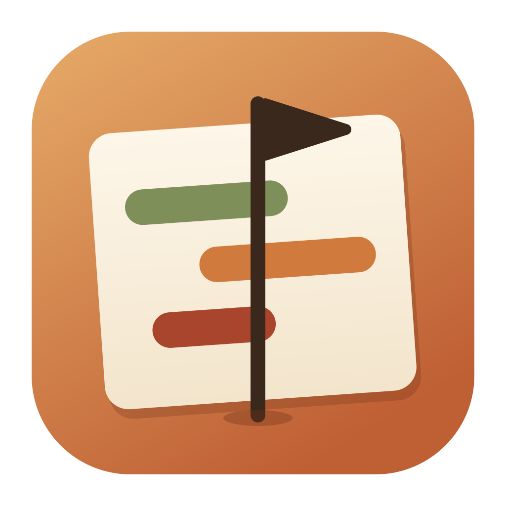
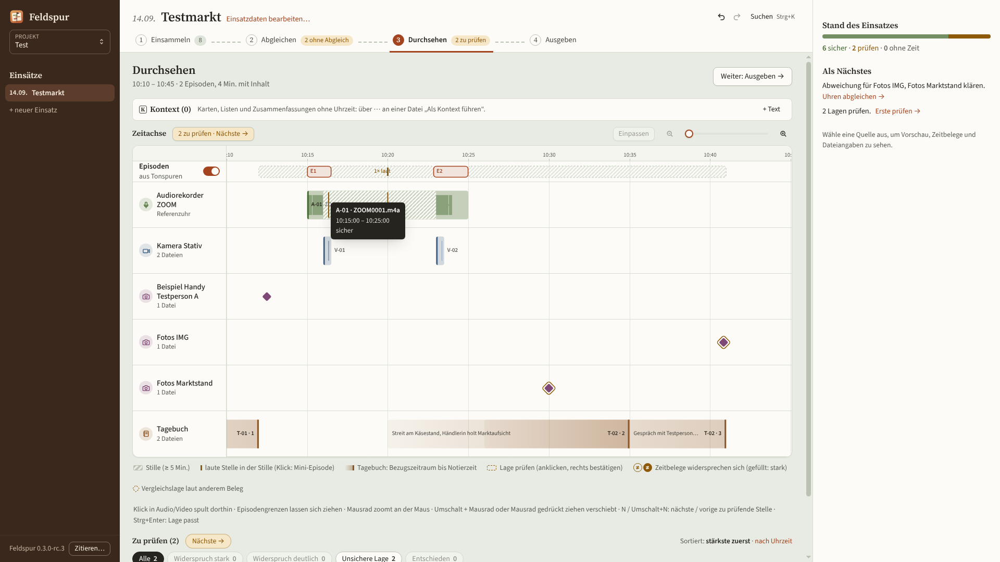
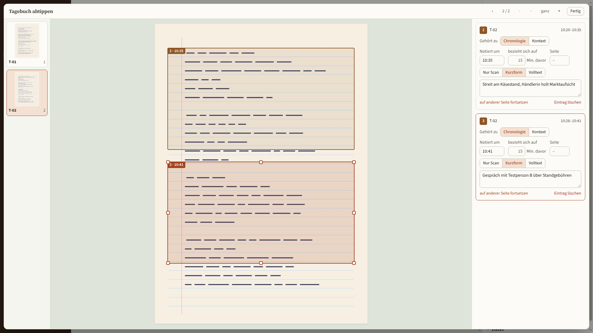

<!-- Erzeugt aus README.qmd und handbuch/ (vp run readme). Bitte dort ändern, nicht hier. -->
<div align="center">



# Feldspur<br><sub><em>Multimediale Feldaufzeichnungen auf einer gemeinsamen Zeitachse zusammenführen</em></sub>

**Zuri Nimca Klaschka** <a href="https://orcid.org/0009-0005-9995-5687"></a><br>
Stand: 16. November 2026

[](https://pklaschka.github.io/feldspur/)
[](https://github.com/pklaschka/feldspur/releases)
[](https://github.com/pklaschka/feldspur/releases)
[](LICENSE)
[](https://github.com/pklaschka/feldspur/actions/workflows/ci.yml)

</div>

> **Zusammenfassung.** Ethnografische Feldeinsätze hinterlassen Tagebuchseiten, Fotos, Audio- und Videoaufnahmen – oft von vielen Geräten,
> deren Uhren selten übereinstimmen. Wie lässt sich daraus ein Material machen, das sich zeitlich geordnet auswerten
> (und zitieren) lässt? Feldspur ist mein Versuch einer Antwort: ein Open-Source-Werkzeug, das dieses Material nach
> Uhrzeit auf eine gemeinsame Achse legt, jede Zuordnung über sichtbare Zeitbelege nachvollziehbar macht und daraus
> ein Dokument mit Zeitmarken für die Analyse in MAXQDA erzeugt. Im Begleittext beschreibe ich den Anlass, ordne
> Feldspur in bestehende Werkzeuge ein und lege offen, wie es mithilfe generativer KI entstanden ist. Das Handbuch
> führt durch die Arbeit mit dem Programm.

> **Schlüsselwörter:** Ethnografie, Feldforschung, qualitative Forschung, Multi-Species-Ethnografie, MAXQDA, Open Science

> [!IMPORTANT]
>
> #### Mit generativer KI entwickelt
>
> Feldspur wird **zu großen Teilen mit generativer KI entwickelt**. Der Großteil des Codes, der Tests und auch der
> Dokumentation wurde von Claude (Anthropic) geschrieben, im Dialog mit mir. Fragestellung, Konzept, Anforderungen und
> Entscheidungen stammen von mir. Feldspur selbst setzt **keine KI** auf Forschungsdaten ein: Es transkribiert nicht
> automatisch, nutzt keine Cloud-Dienste und arbeitet vollständig auf dem eigenen Rechner. Mehr dazu, auch zu meiner
> Haltung zur Nutzung sogenannter KI, im Abschnitt „Entstehung mit generativer KI“.

> [!WARNING]
>
> #### Forschungswerkzeug, (noch) kein Produkt
>
> Feldspur entsteht als Werkzeug für meine eigene ethnografische Forschung. Es richtet sich nach meinen Arbeitsabläufen
> und hat weder stabile Formate noch Support oder Garantien. Projektdateien und Ausgaben können sich zwischen Versionen
> ändern. Wer es ausprobieren möchte, ist herzlich eingeladen. Mit Ecken und Kanten ist aber zu rechnen. Ergebnisse, die in eine
> Analyse oder Veröffentlichung eingehen, sollten daher möglichst an den Originalaufnahmen geprüft werden.



Tagebuch abtippen: Rahmen um einen Eintrag ziehen, Notierzeit, Bezugszeitraum und Kurzform oder Volltext eintragen.
Ein Eintrag kann auf einer anderen Seite weitergehen.



## Entstehung mit generativer KI

### Wer was macht

Feldspur wird **zu großen Teilen mit generativer KI entwickelt**. Der Großteil des Codes, der Tests, der Skripte und
der Dokumentation, auch dieses Texts, wurde von Claude (Anthropic) über Claude Code geschrieben, im Dialog mit mir.
Von mir stammen die Fragestellung, das Konzept, die Anforderungen aus der Feldforschung und die Entscheidungen. Ich gebe
die Richtung vor, sehe Ergebnisse durch und probiere sie aus. Jede Zeile Code lese ich allerdings nicht selbst gegen.
Commits, an denen die KI beteiligt war, tragen im Repository eine `Co-Authored-By`-Zeile.

Für die Entwicklung nutze ich ein Claude-Pro-Abo (ca. 21 € im Monat). Auch das kann sich nicht jede\*r leisten. Ich
erwähne es deshalb zur Transparenz. Und umso wichtiger ist es mir, das Ergebnis als Open Source zur Verfügung zu
stellen.

### Was das für die Nutzung heißt

- Der Code kann Fehler enthalten, die weder Tests noch ich bemerkt haben. Ergebnisse, die in eine Analyse oder
  Veröffentlichung eingehen, bitte an den Originalaufnahmen prüfen.
- Feldspur ist deshalb bewusst auf Nachvollziehbarkeit gebaut: Originale werden nie verändert und über Prüfsummen
  belegt. Jede Lage auf der Zeitachse wird aus sichtbaren Zeitbelegen berechnet. Automatische Vorschläge (z. B.
  Sync-Anker) zählen erst, wenn sie von Hand bestätigt wurden.
- Feldspur selbst setzt **keine KI** auf Forschungsdaten ein: keine automatische Transkription, keine Cloud-Dienste.
  Alles läuft lokal.

Meine Haltung zur Nutzung sogenannter KI steht ausführlich im
[Begleittext](https://pklaschka.github.io/feldspur/#sec-ki).

## Zitieren und archivieren

Wer Feldspur in der eigenen Arbeit verwendet oder darauf verweist, zitiert es bitte mit Version oder Commit. Denn
das Werkzeug verändert sich (noch) stark:

> Klaschka, Z. N. (2026). _Feldspur: Multimediale Feldaufzeichnungen auf einer gemeinsamen Zeitachse zusammenführen_
> (Version 0.1.0) \[Software\]. <https://github.com/pklaschka/feldspur>

Autor\*in: Zuri Nimca Klaschka, ORCID [0009-0005-9995-5687](https://orcid.org/0009-0005-9995-5687).

Die vollständigen Angaben stehen in
[`CITATION.cff`](https://github.com/pklaschka/feldspur/blob/main/CITATION.cff); GitHub bietet daraus „Cite this
repository“ (APA und BibTeX) an. Jedes Release wird auf Zenodo archiviert und erhält dort eine **DOI**. Dieser
Text liegt jedem Release als PDF bei und wird so mit archiviert.

Feldspur steht unter der [EUPL-1.2](https://eupl.eu/1.2/de/). Dieser Text steht unter
[CC BY 4.0](https://creativecommons.org/licenses/by/4.0/deed.de).

Für die Spiegelung nach Zenodo ist das Repository dort einmalig zu aktivieren. Danach erzeugt jede veröffentlichte
GitHub-Release automatisch einen Zenodo-Datensatz mit eigener DOI; die Metadaten stehen in [`.zenodo.json`](.zenodo.json),
die Versionsnummer setzt der Release-Workflow (siehe [Releases](#releases)).

## Lizenz

Copyright © 2026 Zuri Nimca Klaschka. Lizenziert unter der **Open-Source-Lizenz für die Europäische Union
(EUPL) v. 1.2**. Der Lizenztext liegt als [`LICENSE`](LICENSE) (englisch) und [`LIZENZ`](LIZENZ) (deutsch) bei;
alle Sprachfassungen sind gleichermaßen verbindlich, siehe auch [eupl.eu/1.2/de](https://eupl.eu/1.2/de/).
Die EUPL ist eine Copyleft-Lizenz: Wer eine veränderte Fassung weitergibt oder als Dienst anbietet, muss den Quellcode
unter der EUPL (oder einer der im Anhang genannten kompatiblen Lizenzen) zugänglich machen.

Mitgelieferte Software Dritter, etwa FFmpeg (LGPL), behält ihre eigenen Lizenzen, siehe
[`packaging/THIRD-PARTY.md`](packaging/THIRD-PARTY.md). Das Installationspaket enthält alle Lizenztexte unter
`resources/licenses`.

## Aufbau

| Paket                              | Inhalt                                                                                                              |
| ---------------------------------- | ------------------------------------------------------------------------------------------------------------------- |
| [`packages/core`](packages/core)   | Datenmodell (Zod), Zeitbestimmung, Uhrzeiten aus Dateinamen, Projektdatei (SQLite via better-sqlite3 + Drizzle)     |
| [`packages/media`](packages/media) | Einsammeln: Dateiart erkennen, ffprobe/EXIF lesen, SHA-256, Gerätevermutung, Zeitbelege, Import ins Projekt         |
| [`apps/desktop`](apps/desktop)     | Electron-App (React, Tailwind, Radix). Schritte Einsammeln, Abgleichen, Durchsehen (Canvas-Zeitachse), Detailleiste |
| [`scripts`](scripts)               | Entwicklerwerkzeuge                                                                                                 |

Werkzeugkette ist [Vite+](https://viteplus.dev) (`vp`): Vitest, Oxlint, Oxfmt, tsdown, Vite.

Oberfläche: Tailwind CSS v4 (Farben als CSS-Variablen in `styles.css`, hell/dunkel), Radix-Primitive (Reiter, Tooltips,
Regler), Zeitachse auf Canvas (`apps/desktop/src/renderer/timeline.ts`) mit einer verborgenen Liste für Tastatur und
Bildschirmleser.

Bewusste Abweichungen vom Tech-Stack-Dokument (mit Zuri abzustimmen):

- **exifr** statt ExifTool: liest Aufnahmezeiten aus JPEG/HEIC ohne Zusatzprogramm. ExifTool kommt dazu, falls RAW
  oder Videos ohne ffprobe-Zeit gebraucht werden.
- **Eigene Lautstärkekurve** statt FFmpeg-silencedetect: dieselbe Hüllkurve liefert Stille, laute Stellen und
  Klatscher für den Abgleich, ein Durchlauf statt zwei.
- **docx** (9.15.0, MIT) schreibt das Zeitgerüst als Word-Datei, mit eingebetteten Bildern. Kein Zusatzprogramm
  nötig; Pandoc oder LibreOffice wären schwerer mitzuliefern.
- **pdf.js** (`pdfjs-dist`, 6.x) für PDF-Scans in Vorschau und Abtipp-Ansicht.
- **Schriften Source Sans 3 und Source Serif 4** (`@fontsource-variable/…`, SIL OFL 1.1) liegen in der App, damit sie
  auf jedem System gleich aussehen und ohne Netz laden.

## Begriffe im Code

- **Einsatz** (`FieldSession`): ein Feldtag an einem Ort, wird zu einem MAXQDA-Dokument.
- **Gerät** (`Device`): hat eine Uhr. Genau eins pro Einsatz ist die **Referenzuhr**; für die anderen gibt es eine
  **Abweichung** (`clockOffsetMs`, Geräteuhr minus Referenz, positiv = geht vor).
- **Quelle** (`Source`): eine Originaldatei mit Prüfsumme. Kurzzeichen wie im Begleitprotokoll: `V-01`, `A-01`,
  `F-001`, `T-01`. Originale werden nie verändert. Eine Quelle kann **weiteres Bild** einer Seite sein (`partOf`,
  z\. B. Rückseite oder zweiter Scan) und übernimmt dann deren Zeit, oder eine **Folgeaufnahme** (`follows`): ein Gerät,
  das in mehrere Dateien teilt, setzt die vorige Datei nahtlos fort. Folgeaufnahmen erkennt Feldspur beim Einsammeln
  (gleiches Gerät, Beginn = Ende der vorigen ± 3 s, oder GoPro-Kapitel); ohne eigene Zeit beginnt sie am Ende der vorigen.
- **Zeitbeleg** (`TimeEvidence`): eine Angabe, wann eine Stelle der Quelle war: Metadaten, Dateiname, angesagte Uhrzeit,
  Anker oder von Hand. Die Lage auf der Achse wird nie gespeichert, sondern immer aus den Belegen berechnet
  (`resolveTimeline`), damit nachvollziehbar bleibt, worauf sie sich stützt.
- **Sync-Anker** (`SyncAnchor`): „dieser Moment in A = dieser Moment in B“ (Klatschen, Tonspur-Vergleich, von Hand).
  Daraus ergibt sich die Abweichung eines Geräts, oder eine Quelle ohne eigene Zeit erbt ihre Lage.
- **Tonspur-Analyse**: Hüllkurve (100 Werte/s), Leerlauf (Stille ab 5 Min.) und laute Stellen darin (Wachhund) werden
  je Quelle in der Projektdatei zwischengespeichert. Daraus schlägt Feldspur Anker vor: per Kreuzkorrelation bei
  überlappenden Aufnahmen, sonst über Klatscher, bei denen alle Clips eines Geräts gemeinsam über die Uhrabweichung
  abstimmen. Vorschläge zählen erst nach Bestätigung.
- **Episode**: Zeitraum, in dem eine Aufnahme läuft und nicht Leerlauf ist (Lücken unter 5 Min. werden verbunden).
  Dazwischen liegen Zwischenzeiten mit Fotos und Tagebucheinträgen.
- **Geräteuhr**: Abweichung zur Referenzuhr (auch Stunden oder Tage, z. B. „+1 Tag 2:00:00“), dazu optional die
  Zeitzone, auf die die Uhr gestellt war. Als UTC markierte Stempel („…Z“) gelten als UTC. Eine von Hand gesetzte
  Zeit in einem Clip kann die Uhr des ganzen Geräts richten; die übrigen Clips rücken dann mit.
- **Mitschrift** (`TranscriptLine`): von Hand mitgetippte Zeilen zu einer Ton- oder Videoquelle, mit Sprecherkürzel.
  Gespeichert wird die Stelle in der Aufnahme; die Uhrzeit folgt aus dem Abgleich. Kein automatisches Transkript.
- **Ausgabe**: ein Ordner pro Einsatz. Das **Zeitgerüst** (.docx) hat je Zeile eine Zeitmarke `#hh:mm:ss-z#` ins
  Montagevideo und die Uhrzeit dahinter, mit Mitschrift, Fotos und Tagebuch-Ausschnitten (auch aus PDFs). Das
  **Montagevideo** zeigt nur, was zum Zuordnen nötig ist: Uhrzeit, die laufenden Videos (bis zu vier nebeneinander) mit
  Kurzzeichen, Datei und Stelle im Original, die laufenden Tonquellen und eine **Montage-ID**, die auch im Kopf des
  Zeitgerüsts steht. Der Ton aller laufenden Geräte liegt übereinander (abschaltbar: nur die Hauptquelle). Wahlweise
  nach Episoden (Zeit dazwischen als kurze Tafel) oder in Echtzeit am Stück. Die Einblendungen zeichnet die Oberfläche,
  weil die LGPL-Fassung von FFmpeg keine Schrift setzt; „Montage ansehen“ spielt dieselbe Montage ohne Rechnen aus den
  Originalen ab. Dazu ein **Begleitprotokoll** (.csv) mit Herkunft und Zeitnachweis jeder Datei.
- **Tagebucheintrag** (`DiaryEntry`): Rahmen auf einer oder mehreren Scan-Seiten mit Notierzeit. Der
  **Bezugszeitraum** reicht vor die Notierzeit zurück (Standard 15 Min. pro Einsatz). Zeitgerüst, Montage, Mitschrift
  und Suche führen den Eintrag an der Notierzeit; der Bezugszeitraum steht als Hinweis dabei.

Alle Uhrzeiten sind Ortszeit des Einsatzes, intern als `LocalMs` (Wanduhrzeit in ms, gelesen als UTC). Unsicherheiten
werden als Wurzel der Quadratsumme kombiniert; „sicher“ heißt ± 2 s oder besser bei bekannter Geräteuhr.

## Entwickeln

Voraussetzungen: [Vite+](https://viteplus.dev) (`vp`, bringt Node und pnpm mit), FFmpeg (`ffmpeg`, `ffprobe`) im PATH.

```sh
vp install
vp run check       # Format, Lint, Typen
vp run test        # Vitest; Medien-Fixtures werden zur Laufzeit mit FFmpeg erzeugt
vp run @feldspur/desktop#native   # better-sqlite3 für Electron holen (einmalig)
vp run desktop     # App bauen und starten
vp run e2e         # Rauchtest der App (Linux ohne Bildschirm: xvfb-run -a vp run e2e)
```

Einen Ordner ohne App durchprobieren, z. B. das erfundene Testpaket:

```sh
vp run probe /pfad/1_Rohquellen --reference ZOOM0004.m4a \
  --anchor ZOOM0004.m4a@80=C0012.MP4@20 --diary Tagebuch_S01.jpg@10:12
```

Abgleich mit dem Begleitprotokoll des Testpakets als Test:
`FELDSPUR_TESTPAKET=/pfad/1_Rohquellen vp run test`.

## Handbuch und README

Begleittext und Handbuch liegen als [Quarto](https://quarto.org)-Manuskript in [`handbuch/`](handbuch) (Text unter
CC BY 4.0). **Diese README wird aus `README.qmd` und denselben Textbausteinen erzeugt**; Änderungen bitte dort machen.
Bauen mit Quarto 1.9 im PATH:

```sh
quarto render handbuch                 # Webseite und PDF nach handbuch/_site/ (auch: vp run handbook)
vp run readme                          # README.md aus README.qmd neu erzeugen (quarto render + vp fmt)
```

Das PDF setzt das in Quarto enthaltene Typst, LaTeX ist nicht nötig. Die Webseite lädt nichts von fremden Servern
(keine CDNs, keine Webfonts) und setzt keine Cookies; `handbuch/extern-pruefen.ts` prüft das nach jedem Rendern. Der Workflow
„Handbuch-Webseite“ prüft außerdem, dass README.md zu den Quellen passt, und veröffentlicht die Seite bei Änderungen
auf main über GitHub Pages (einmalig unter Settings → Pages die Quelle „GitHub Actions“ wählen). Bildschirmfotos in
`handbuch/bilder/` zeigen nur erfundene Daten.

## Installationspaket

Die Installer (Windows NSIS, macOS DMG, Linux AppImage) baut der Workflow „Installationspaket“ in GitHub Actions,
von Hand, bei Änderungen an der Paketierung und als Teil jeder Release; die Dateien liegen danach als Artefakte am
Lauf. Das App-Symbol liegt als [`packaging/icon.svg`](packaging/icon.svg) (Quelle) und `packaging/icon.png` (1024 px,
daraus erzeugt electron-builder `.icns` und `.ico`). Lokal für die eigene Plattform:

```sh
vp run @feldspur/desktop#build
vp run @feldspur/desktop#native
node scripts/fetch-ffmpeg.mjs          # LGPL-FFmpeg; auf macOS wird aus den Quellen gebaut
node scripts/package-desktop.mjs       # --dir: nur entpackt, ohne Installer
```

Mitgeliefert wird die **LGPL-Fassung** von FFmpeg als eigenständige Programme unter `resources/bin`
(Windows/Linux: BtbN-Builds, macOS: eigener Build ohne GPL-Teile). Lizenztexte und Build-Angaben liegen unter
`resources/licenses`, siehe [`packaging/THIRD-PARTY.md`](packaging/THIRD-PARTY.md). Die App findet die Programme dort
von selbst; `FELDSPUR_FFMPEG`/`FELDSPUR_FFPROBE` überschreiben das. Das Paket ist noch nicht signiert.

**Keine echten Forschungsdaten** ins Repository oder in Tests. Fixtures werden erzeugt oder sind erfunden.

## Releases

Versioniert wird nur die App (Tags `v0.2.0`, `v0.2.0-rc.1`); `packages/*` laufen ohne eigene Releases mit.
Eine Release startet von Hand: **Actions → Release → Run workflow**, Version eintragen.

- **Version:** `0.2.0` für ein Release, `0.2.0-rc.1` (oder `-alpha.N`, `-beta.N`) für eine Vorabversion.
- **Sichtbarkeit:** Standard ist „Vorabversionen als Entwurf“. Entwürfe sehen nur Personen mit Schreibrechten, und
  Zenodo archiviert sie nicht. So bekommen Release Candidates keine eigene DOI. Ein Entwurf lässt sich später unter
  Releases von Hand veröffentlichen; dann archiviert Zenodo ihn doch.
- **Probelauf:** baut alles und zeigt Changelog und Release-Text in der Zusammenfassung, pusht aber nichts.

Der Workflow prüft und testet, schreibt den Abschnitt in [`CHANGELOG.md`](CHANGELOG.md), setzt die Version in
`package.json`, `apps/desktop/package.json`, `CITATION.cff` und `.zenodo.json`, committet „Release vX“ auf `main`,
taggt, baut die Installer für alle Plattformen und legt die GitHub-Release mit Installern, `SHA256SUMS.txt` und dem
PDF-Handbuch an. Das Handbuch rendert [`handbook.yml`](.github/workflows/handbook.yml) mit Quarto
und hängt es als `Feldspur-Handbuch-<version>.pdf` an.

Das Changelog entsteht aus den **Titeln der zusammengeführten Pull Requests**, deshalb sollten die Titel für
Nutzer\*innen verständlich sein. Die Rubrik ergibt sich aus dem Label: `neu`, `verbessert`, `behoben`, `doku`, `intern`;
`kein-changelog` lässt einen PR weg (siehe [`.github/release.yml`](.github/release.yml)). Direkt auf `main` gepushte
Commits erscheinen nicht. Beim Release fasst das Changelog die Abschnitte der zugehörigen Vorabversionen zusammen.

## Noch offen

- Ausgabe: Dokumentvariablen im Zeitgerüst; Resolve-Schnittliste in Resolve selbst erproben.
- Vorschau-Kopien für Formate, die Chromium nicht abspielt (z. B. HEVC, manche WAV-Varianten).
- Episodengrenzen auf der Zeitachse verschieben, laute Stellen zur Mini-Episode machen, Wellenform in den Spuren.
- ExifTool statt exifr für RAW/HEIC.
- Code-Signatur (Windows, macOS-Notarisierung).
