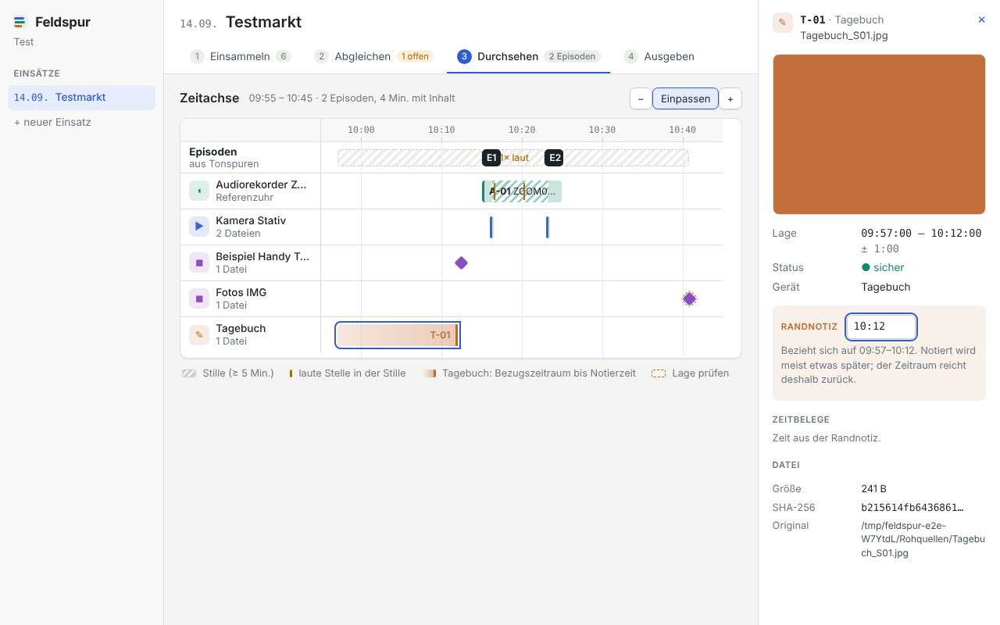
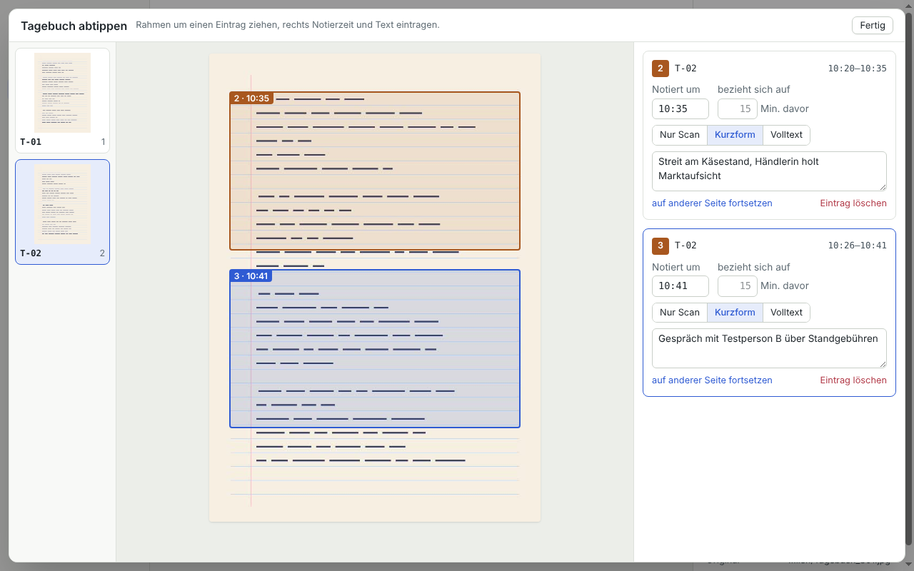

# Feldspur

Feldspur legt alle Aufzeichnungen eines ethnografischen Feldeinsatzes (Tagebuchscans, Video, Audio, Fotos, Notizen) auf
**eine gemeinsame Uhrzeit-Achse** und macht daraus später ein codierbares Quelldokument, zuerst für MAXQDA.

> [!IMPORTANT]
> **Forschungswerkzeug, (noch) kein Produkt.** Feldspur entsteht als Werkzeug für meine eigene ethnografische
> Forschung. Es richtet sich nach meinen Arbeitsabläufen, ist nicht für die allgemeine Nutzung gedacht und hat weder
> stabile Formate noch Support, Installationshilfe oder Garantien. Projektdateien und Exporte können sich zwischen
> Versionen ohne Übergang ändern. Wer es trotzdem ausprobieren möchte, ist willkommen, sollte aber mit Ecken und Kanten
> rechnen.

Arbeitstitel, Stand: in Entwicklung (Einsammeln, Zeitbestimmung, Abgleich, Durchsehen und Tagebuch abtippen
funktionieren; der Export steht noch aus). Konzept und Tech-Stack sind außerhalb des Repositorys dokumentiert.



Tagebuch abtippen: Rahmen um einen Eintrag ziehen, Notierzeit, Bezugszeitraum und Kurzform oder Volltext eintragen.
Ein Eintrag kann auf einer anderen Seite weitergehen.



## Entstehung mit KI

Feldspur wird **zu großen Teilen mit generativer KI entwickelt**. Der Großteil des Codes, der Tests, der Skripte und
dieser Dokumentation wurde von Claude (Anthropic) über Claude Code geschrieben, im Dialog mit mir. Von mir stammen die
Fragestellung, das Konzept, die Anforderungen aus der Feldforschung und die Entscheidungen; ich gebe die Richtung vor,
sehe Ergebnisse durch und probiere sie aus. Ich lese aber nicht jede Zeile Code selbst gegen. Commits, an denen die KI
beteiligt war, tragen eine `Co-Authored-By`-Zeile.

Was das für die Nutzung heißt:

- Der Code kann Fehler enthalten, die weder Tests noch ich bemerkt haben. Ergebnisse, die in eine Analyse oder
  Veröffentlichung eingehen, bitte an den Originalaufnahmen prüfen.
- Feldspur ist deshalb bewusst auf Nachvollziehbarkeit gebaut: Originale werden nie verändert und über Prüfsummen
  belegt, jede Lage auf der Zeitachse wird aus sichtbaren Zeitbelegen berechnet, und automatische Vorschläge (z. B.
  Sync-Anker) zählen erst, wenn sie von Hand bestätigt wurden.
- Feldspur selbst setzt **keine KI** auf Forschungsdaten ein: keine automatische Transkription, keine Cloud-Dienste.
  Alles läuft lokal.

## Zitieren

Wer Feldspur in der eigenen Arbeit verwendet oder darauf verweist, findet die Zitierangaben in
[`CITATION.cff`](CITATION.cff); GitHub bietet daraus oben rechts „Cite this repository“ (APA und BibTeX) an. Kurzform:

> Klaschka, Z. N. (2026). _Feldspur: Multimediale Feldaufzeichnungen auf einer gemeinsamen Zeitachse zusammenführen_
> (Version 0.1.0) [Software]. https://github.com/pklaschka/feldspur

Bitte die tatsächlich verwendete Version oder den Commit angeben, da sich das Werkzeug noch stark verändert.

## Aufbau

| Paket                              | Inhalt                                                                                                              |
| ---------------------------------- | ------------------------------------------------------------------------------------------------------------------- |
| [`packages/core`](packages/core)   | Datenmodell (Zod), Zeitbestimmung, Uhrzeiten aus Dateinamen, Projektdatei (SQLite via better-sqlite3 + Drizzle)     |
| [`packages/media`](packages/media) | Einsammeln: Dateiart erkennen, ffprobe/EXIF lesen, SHA-256, Gerätevermutung, Zeitbelege, Import ins Projekt         |
| [`apps/desktop`](apps/desktop)     | Electron-App (React, Tailwind, Radix). Schritte Einsammeln, Abgleichen, Durchsehen (Canvas-Zeitachse), Detailleiste |
| [`scripts`](scripts)               | Entwicklerwerkzeuge                                                                                                 |

Werkzeugkette ist [Vite+](https://viteplus.dev) (`vp`): Vitest, Oxlint, Oxfmt, tsdown, Vite.

Oberfläche: Tailwind CSS v4 (Farben als CSS-Variablen in `styles.css`, hell/dunkel), Radix-Primitive (Reiter, Tooltips,
Regler), Zeitachse auf Canvas (`apps/desktop/src/renderer/timeline.ts`) mit einer verborgenen Liste für Tastatur und
Bildschirmleser.

Bewusste Abweichungen vom Tech-Stack-Dokument (mit Zuri abzustimmen):

- **exifr** statt ExifTool: liest Aufnahmezeiten aus JPEG/HEIC ohne Zusatzprogramm. ExifTool kommt dazu, falls RAW
  oder Videos ohne ffprobe-Zeit gebraucht werden.
- **Eigene Lautstärkekurve** statt FFmpeg-silencedetect: dieselbe Hüllkurve liefert Stille, laute Stellen und
  Klatscher für den Abgleich, ein Durchlauf statt zwei.

## Begriffe im Code

- **Einsatz** (`FieldSession`): ein Feldtag an einem Ort, wird zu einem MAXQDA-Dokument.
- **Gerät** (`Device`): hat eine Uhr. Genau eins pro Einsatz ist die **Referenzuhr**; für die anderen gibt es eine
  **Abweichung** (`clockOffsetMs`, Geräteuhr minus Referenz, positiv = geht vor).
- **Quelle** (`Source`): eine Originaldatei mit Prüfsumme. Kurzzeichen wie im Begleitprotokoll: `V-01`, `A-01`,
  `F-001`, `T-01`. Originale werden nie verändert.
- **Zeitbeleg** (`TimeEvidence`): eine Angabe, wann eine Stelle der Quelle war: Metadaten, Dateiname, angesagte Uhrzeit,
  Anker oder von Hand. Die Lage auf der Achse wird nie gespeichert, sondern immer aus den Belegen berechnet
  (`resolveTimeline`), damit nachvollziehbar bleibt, worauf sie sich stützt.
- **Sync-Anker** (`SyncAnchor`): „dieser Moment in A = dieser Moment in B“ (Klatschen, Tonspur-Vergleich, von Hand).
  Daraus ergibt sich die Abweichung eines Geräts, oder eine Quelle ohne eigene Zeit erbt ihre Lage.
- **Tonspur-Analyse**: Hüllkurve (100 Werte/s), Leerlauf (Stille ab 5 Min.) und laute Stellen darin (Wachhund) werden
  je Quelle in der Projektdatei zwischengespeichert. Daraus schlägt Feldspur Anker vor: per Kreuzkorrelation bei
  überlappenden Aufnahmen, sonst über Klatscher, bei denen alle Clips eines Geräts gemeinsam über die Uhrabweichung
  abstimmen. Vorschläge zählen erst nach Bestätigung.
- **Episode**: Zeitraum, in dem eine Aufnahme läuft und nicht Leerlauf ist (Lücken unter 5 Min. werden verbunden).
  Dazwischen liegen Zwischenzeiten mit Fotos und Tagebucheinträgen.
- **Tagebucheintrag** (`DiaryEntry`): Rahmen auf einer oder mehreren Scan-Seiten mit Notierzeit. Der
  **Bezugszeitraum** reicht vor die Notierzeit zurück (Standard 15 Min. pro Einsatz).

Alle Uhrzeiten sind Ortszeit des Einsatzes, intern als `LocalMs` (Wanduhrzeit in ms, gelesen als UTC). Unsicherheiten
werden als Wurzel der Quadratsumme kombiniert; „sicher“ heißt ± 2 s oder besser bei bekannter Geräteuhr.

## Entwickeln

Voraussetzungen: [Vite+](https://viteplus.dev) (`vp`, bringt Node und pnpm mit), FFmpeg (`ffmpeg`, `ffprobe`) im PATH.

```sh
vp install
vp run check       # Format, Lint, Typen
vp run test        # Vitest; Medien-Fixtures werden zur Laufzeit mit FFmpeg erzeugt
vp run @feldspur/desktop#native   # better-sqlite3 für Electron holen (einmalig)
vp run desktop     # App bauen und starten
vp run e2e         # Rauchtest der App (Linux ohne Bildschirm: xvfb-run -a vp run e2e)
```

Einen Ordner ohne App durchprobieren, z. B. das erfundene Testpaket:

```sh
vp run probe /pfad/1_Rohquellen --reference ZOOM0004.m4a \
  --anchor ZOOM0004.m4a@80=C0012.MP4@20 --diary Tagebuch_S01.jpg@10:12
```

Abgleich mit dem Begleitprotokoll des Testpakets als Test:
`FELDSPUR_TESTPAKET=/pfad/1_Rohquellen vp run test`.

## Installationspaket

Die Installer (Windows NSIS, macOS DMG, Linux AppImage) baut der Workflow „Installationspaket“ in GitHub Actions,
von Hand oder bei einem Tag `v*`; die Dateien liegen danach als Artefakte am Lauf. Lokal für die eigene Plattform:

```sh
vp run @feldspur/desktop#build
vp run @feldspur/desktop#native
node scripts/fetch-ffmpeg.mjs          # LGPL-FFmpeg; auf macOS wird aus den Quellen gebaut
node scripts/package-desktop.mjs       # --dir: nur entpackt, ohne Installer
```

Mitgeliefert wird die **LGPL-Fassung** von FFmpeg als eigenständige Programme unter `resources/bin`
(Windows/Linux: BtbN-Builds, macOS: eigener Build ohne GPL-Teile). Lizenztexte und Build-Angaben liegen unter
`resources/licenses`, siehe [`packaging/THIRD-PARTY.md`](packaging/THIRD-PARTY.md). Die App findet die Programme dort
von selbst; `FELDSPUR_FFMPEG`/`FELDSPUR_FFPROBE` überschreiben das. Das Paket ist noch nicht signiert.

**Keine echten Forschungsdaten** ins Repository oder in Tests. Fixtures werden erzeugt oder sind erfunden.

## Noch offen

- Exportformat (Zeitgerüst + Tagesvideo) wartet auf den MAXQDA-Test.
- Vorschau-Kopien für Formate, die Chromium nicht abspielt (z. B. HEVC, manche WAV-Varianten).
- Episodengrenzen auf der Zeitachse verschieben, laute Stellen zur Mini-Episode machen, Wellenform in den Spuren.
- Tagebuch: PDF-Scans in der Abtipp-Ansicht anzeigen (bisher nur JPG/PNG).
- ExifTool statt exifr für RAW/HEIC.
- Code-Signatur (Windows, macOS-Notarisierung) und ein App-Symbol.
