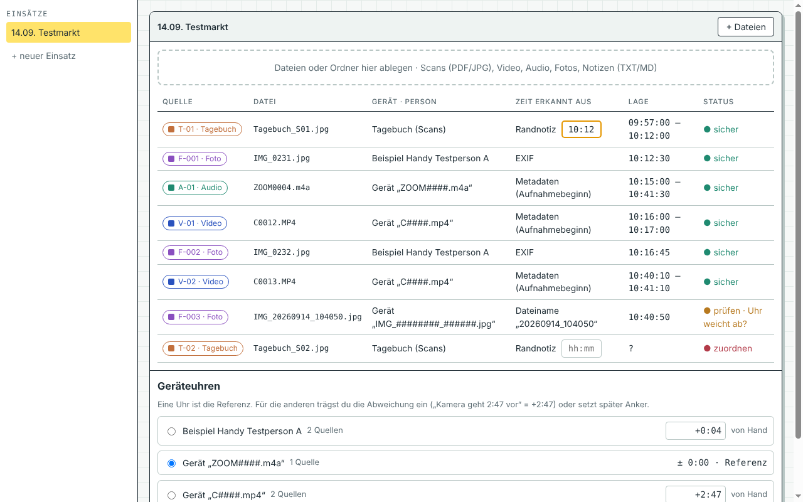

# Feldspur

Feldspur legt alle Aufzeichnungen eines ethnografischen Feldeinsatzes (Tagebuchscans, Video, Audio, Fotos, Notizen) auf
**eine gemeinsame Uhrzeit-Achse** und macht daraus später ein codierbares Quelldokument, zuerst für MAXQDA.

Arbeitstitel, Stand: erste Implementierungsschritte (Einsammeln und Zeitbestimmung). Konzept und Tech-Stack sind im
Projekt außerhalb des Repositorys dokumentiert.



## Aufbau

| Paket                              | Inhalt                                                                                                                |
| ---------------------------------- | --------------------------------------------------------------------------------------------------------------------- |
| [`packages/core`](packages/core)   | Datenmodell (Zod), Zeitbestimmung, Uhrzeiten aus Dateinamen, Projektdatei (SQLite via better-sqlite3 + Drizzle)       |
| [`packages/media`](packages/media) | Einsammeln: Dateiart erkennen, ffprobe/EXIF lesen, SHA-256, Gerätevermutung, Zeitbelege, Import ins Projekt           |
| [`apps/desktop`](apps/desktop)     | Electron-App (React). Bisher: Projekt anlegen/öffnen, Einsätze, Import-Ansicht wie Skizze A, Geräteuhren, Randnotizen |
| [`scripts`](scripts)               | Entwicklerwerkzeuge                                                                                                   |

Werkzeugkette ist [Vite+](https://viteplus.dev) (`vp`): Vitest, Oxlint, Oxfmt, tsdown, Vite.

## Begriffe im Code

- **Einsatz** (`FieldSession`): ein Feldtag an einem Ort, wird zu einem MAXQDA-Dokument.
- **Gerät** (`Device`): hat eine Uhr. Genau eins pro Einsatz ist die **Referenzuhr**; für die anderen gibt es eine
  **Abweichung** (`clockOffsetMs`, Geräteuhr minus Referenz, positiv = geht vor).
- **Quelle** (`Source`): eine Originaldatei mit Prüfsumme. Kurzzeichen wie im Begleitprotokoll: `V-01`, `A-01`,
  `F-001`, `T-01`. Originale werden nie verändert.
- **Zeitbeleg** (`TimeEvidence`): eine Angabe, wann eine Stelle der Quelle war: Metadaten, Dateiname, angesagte Uhrzeit,
  Anker oder von Hand. Die Lage auf der Achse wird nie gespeichert, sondern immer aus den Belegen berechnet
  (`resolveTimeline`), damit nachvollziehbar bleibt, worauf sie sich stützt.
- **Sync-Anker** (`SyncAnchor`): „dieser Moment in A = dieser Moment in B“ (Klatschen, Tonspur-Vergleich, von Hand).
  Daraus ergibt sich die Abweichung eines Geräts, oder eine Quelle ohne eigene Zeit erbt ihre Lage.
- **Tagebucheintrag** (`DiaryEntry`): Rahmen auf einer oder mehreren Scan-Seiten mit Notierzeit. Der
  **Bezugszeitraum** reicht vor die Notierzeit zurück (Standard 15 Min. pro Einsatz).

Alle Uhrzeiten sind Ortszeit des Einsatzes, intern als `LocalMs` (Wanduhrzeit in ms, gelesen als UTC). Unsicherheiten
werden als Wurzel der Quadratsumme kombiniert; „sicher“ heißt ± 2 s oder besser bei bekannter Geräteuhr.

## Entwickeln

Voraussetzungen: Node 22+, pnpm 10, FFmpeg (`ffmpeg`, `ffprobe`) im PATH.

```sh
pnpm install
pnpm check         # Format, Lint, Typen
pnpm test          # Vitest; Medien-Fixtures werden zur Laufzeit mit FFmpeg erzeugt
pnpm --filter @feldspur/desktop native   # better-sqlite3 für Electron holen (einmalig)
pnpm desktop       # App bauen und starten
pnpm e2e           # Rauchtest der App (Linux ohne Bildschirm: xvfb-run -a pnpm e2e)
```

Einen Ordner ohne App durchprobieren, z. B. das erfundene Testpaket:

```sh
pnpm probe /pfad/1_Rohquellen --reference ZOOM0004.m4a \
  --anchor ZOOM0004.m4a@80=C0012.MP4@20 --diary Tagebuch_S01.jpg@10:12
```

Abgleich mit dem Begleitprotokoll des Testpakets als Test:
`FELDSPUR_TESTPAKET=/pfad/1_Rohquellen pnpm test`.

**Keine echten Forschungsdaten** ins Repository oder in Tests. Fixtures werden erzeugt oder sind erfunden.

## Noch offen

- Exportformat (Zeitgerüst + Tagesvideo) wartet auf den MAXQDA-Test.
- Zeitabgleich-Oberfläche (Skizze B): Anker setzen, Klatschen/Tonspur automatisch finden.
- Zeitachse (Skizze C/D), Episoden und Leerlauf-Erkennung.
- Tagebuch: Rahmen auf Scans ziehen, Kurzform/Volltext, Einträge über Seiten verketten.
- ExifTool statt exifr für RAW/HEIC, mitgelieferte FFmpeg-Programme, Paketierung mit electron-builder.
