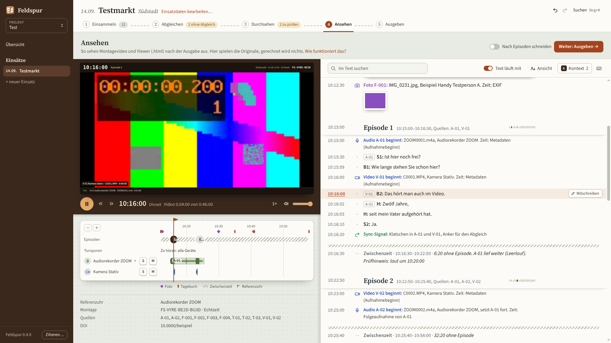

## Ansehen {#sec-ansehen}

Im Schritt **Ansehen** siehst du Montage und Einsatztranskript so, wie sie nach der Ausgabe im Viewer (@sec-viewer)
aussehen. Gerechnet wird dabei nichts: Links spielen die Originale an der Stelle, an der sie im Montagevideo stehen,
rechts läuft das Einsatztranskript mit. So fällt vor der Ausgabe auf, was noch nicht stimmt.

{#fig-ansehen}

Bedient wird der Schritt wie der Viewer: Ein Klick auf eine Zeile springt zur Stelle, die Zeitleiste zeigt Episoden,
Fotos, Tagebuch und je Gerät eine Spur, und die Taste [?]{.kbd} zeigt alle Tasten. Hat der Einsatz mehrere Geräte,
hörst du sie gleich einzeln: Jede Gerätespur hat die Knöpfe **S** (nur diese Spur) und **M** (stumm). Hat der
Einsatz Episoden, wählst du mit **Nach Episoden schneiden**, welche Fassung du siehst; der Schalter ist derselbe wie
in „Ausgeben“.

### Von der Zeile zur Bearbeitung

Fällt dir ein Fehler auf, führt der Knopf mit dem Stift an der Zeile dorthin, wo sie entsteht. Er erscheint, wenn du
mit der Maus über die Zeile fährst, steht immer an der Zeile, die gerade läuft, und nennt sein Ziel. Die Taste
[E]{.kbd} bearbeitet die laufende Zeile.

| Zeile                   | Knopf            | öffnet                                                   |
| ----------------------- | ---------------- | -------------------------------------------------------- |
| Mitschrift              | **Mitschreiben** | das Mitschreiben an dieser Stelle (@sec-mitschreiben)    |
| Tagebucheintrag         | **Tagebuch**     | die Tagebuchseite zum Abtippen (@sec-tagebuch)           |
| Aufnahme, Foto, Episode | **Durchsehen**   | „Durchsehen“ mit der Quelle oder Episode (@sec-durchsehen) |
| Sync-Signal             | **Abgleichen**   | „Abgleichen“ mit der Aufnahme (@sec-abgleichen)          |

: Wohin der Stift an einer Zeile führt {#tbl-ansehen-bearbeiten}

Zurück in „Ansehen“ stehst du wieder an derselben Stelle, und die Änderung ist schon zu sehen.

::: {.callout-note}
### Zitiert wird aus der Ausgabe
„Ansehen“ zeigt den Stand von jetzt, die Ausgabe hält einen Stand fest. **Stelle kopieren** gibt es
deshalb nur im ausgegebenen Viewer; zitiere aus der Ausgabe (@sec-stelle-zitieren).
:::
