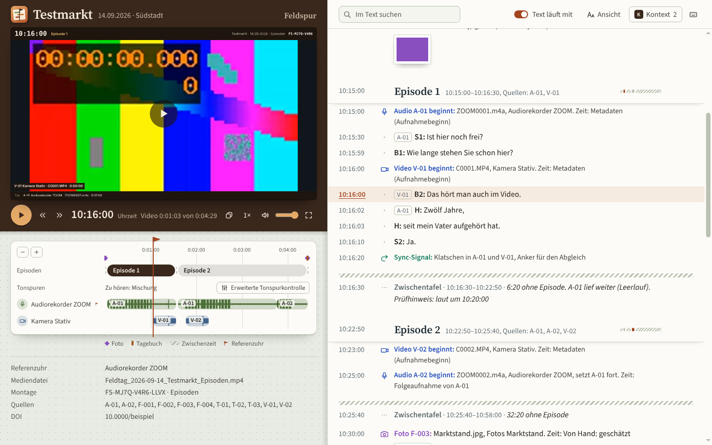

## Ausgeben {#sec-ausgeben}

Im letzten Schritt schreibt Feldspur mit **Ausgeben…** einen **Ordner pro Einsatz**: Einsatztranskript,
Dokumentvariablen und Begleitprotokoll, dazu auf Wunsch Montagevideo, Viewer und Schnittliste. Ist vorher noch etwas
offen, etwa eine Uhr ohne Abgleich, heißt der Knopf **Trotzdem ausgeben…**, und unter **Noch offen** stehen Links
dorthin.

Den Stand der letzten Ausgabe merkt sich Feldspur in der Projektdatei, auch über einen Neustart hinweg. Oben im Schritt
steht dann, wann und wohin ausgegeben wurde, und ob die Ausgabe noch passt. **Im Ordner zeigen** öffnet den
Ausgabeordner.

- **Aktuell** (direkt nach der Ausgabe **Fertig**): Einsatz, Originale und Einstellungen sind genau wie bei der Ausgabe.
- **Veraltet**: Seitdem hat sich etwas geändert. Darunter steht, was: der Einsatz selbst (Zeiten, Mitschrift, Tagebuch,
  Episoden, Angaben), neue oder entfernte Quellen, veränderte oder fehlende Originale (mit Kurzzeichen) oder andere
  Einstellungen als damals, z. B. jetzt mit Montagevideo. Machst du eine Änderung rückgängig, ist die Ausgabe wieder
  aktuell.
- Fehlen Dateien im **Ausgabeordner**, sind sie durchgestrichen.

{#fig-ausgeben-veraltet}

Ist die Ausgabe veraltet oder fehlen Dateien, rechnet **Erneut ausgeben…** nur das Geänderte neu und geht ohne Nachfrage in den Ordner der letzten Ausgabe (der
Knopf nennt ihn als Hinweis). Für einen anderen Ordner gibt es **In anderen Ordner ausgeben…**; der Ordnerdialog
beginnt dann beim bisherigen Ordner. Ist eine Datei der letzten Ausgabe noch in Word, Excel oder MAXQDA geöffnet, meldet
Feldspur das gleich zu Beginn („… ist noch in einem anderen Programm geöffnet“) und nicht erst nach dem Video. Feldspur ist dabei vorsichtig: Lieber einmal zu oft „Veraltet“ als
eine alte Ausgabe, die als aktuell gilt.

Erster Schritt jeder Ausgabe, gleich nach der Wahl des Ordners, ist die Prüfung der Originale mit ihrer Prüfsumme
(@sec-originale). Bei großen Einsätzen dauert das einige Minuten; der Balken zeigt, wie viele Gigabyte schon geprüft
sind, und **Abbrechen** geht auch hier. Schon geprüfte Dateien merkt sich Feldspur, bis die App beendet wird. Ist alles
da und unverändert, geht die Ausgabe ohne Halt weiter. Sonst hält sie an, bevor etwas geschrieben ist, und es steht da,
was auffällt:

- **Fehlt** eine Datei, die die Ausgabe braucht, geht es erst nach dem Neu-Verknüpfen weiter. Gebraucht werden Fotos
  und Tagebuchseiten (für das Einsatztranskript) und, mit Montagevideo, alle Ton- und Videoaufnahmen.
- **Verändert** ist eine Datei, wenn sie nicht mehr dieselbe ist wie beim Einsammeln. Mit **Trotzdem ausgeben**
  geht es bewusst weiter, in den schon gewählten Ordner; das Begleitprotokoll nennt weiter die Prüfsumme vom Einsammeln. Ebenso bei fehlenden
  Dateien, die diese Ausgabe nicht braucht (z. B. Ton ohne Montagevideo).

{#fig-ausgeben}

### Einsatztranskript (.docx)

Das **Einsatztranskript** (bis Version 0.2 "Zeitgerüst") ist das Dokument für MAXQDA. Jede Zeile beginnt mit einer Zeitmarke im Format `#hh:mm:ss-z#`, die
auf die passende Stelle im Montagevideo zeigt, und nennt die Uhrzeit dahinter. Dazu kommen Mitschrift, Fotos und
Ausschnitte aus den Tagebuchseiten, auch aus PDFs. Im Kopf stehen die Einsatzdaten und die **Montage-ID**. Zeilenumbrüche in einem abgetippten Tagebuchtext bleiben
erhalten; der Eintrag bleibt dabei ein Absatz mit einer einzigen Zeitmarke.

Gibt es Kontext (@sec-kontext), steht vor der ersten Zeitmarke ein Abschnitt **Kontext** mit allen Stücken ohne
Zeitmarke, jedes als "Kontext · Titel" mit Fundstelle, Bild und Text. Die Zeitmarken beginnen danach unter
**Chronologie**. Weil der Kontext keine Zeitmarke trägt, verknüpft MAXQDA ihn mit keiner Stelle im Video; codieren
lässt er sich wie jeder andere Text. Das Montagevideo bleibt unverändert. In der Karte **Kontext** links legst du die
Reihenfolge fest.

### Montagevideo (.mp4)

Das **Montagevideo** legt Bild und Ton aller Aufnahmen des Einsatzes auf die gemeinsame Zeitachse. Es zeigt die
Uhrzeit, die gerade laufenden Videos (bis zu vier nebeneinander) mit Kurzzeichen, Datei und Stelle im Original, die
laufenden Tonquellen und die Montage-ID. Fotos und Tagebuch stehen schon im Einsatztranskript und fehlen deshalb im Video.

Einsatztranskript und Montagevideo gehören zusammen: **Erst beide zusammen** geben das Material eines Einsatzes vollständig
und zeitlich zugeordnet wieder. Das Einsatztranskript enthält, was als Text vorliegt, dazu Fotos und Tagebuchausschnitte. Das
Montagevideo enthält Bild und Ton auch dort, wo nichts mitgeschrieben ist. Oft wird der Großteil im Einsatztranskript
codiert. Was sich sehen oder hören, aber schwer in Worte fassen lässt, codierst du direkt im Video. In der
Multispecies-Ethnografie ist das häufig so, etwa beim Verhalten nichtmenschlicher Tiere.

Optionen:

- **Montagevideo mit ausgeben** (Standard): Ohne Haken entstehen nur Einsatztranskript, Dokumentvariablen und
  Begleitprotokoll.
- Standardmäßig läuft das Video **in Echtzeit** am Stück: Videozeit gleich Uhrzeit ab Beginn.
- **Nach Episoden schneiden** (nur wenn unter "Durchsehen" Episoden eingeschaltet sind): Episoden in voller Länge,
  Zeit dazwischen als kurze Tafel. Das Video wird kürzer, die Videozeit entspricht dann aber nicht mehr der Uhrzeit.
  Alles aus der Zeit dazwischen (Mitschrift, Fotos, Tagebuch) steht im Einsatztranskript an der Tafel, nach Uhrzeit
  geordnet.
- **Ton aller Geräte mischen**: sonst nur die Haupttonquelle.
- **Zusätzlich eine Tonspur je Gerät** (Standard): Die Mischung (oder Haupttonquelle) bleibt Tonspur 1 und ist als
  Standard markiert; MAXQDA und jeder Player spielen sie wie bisher. Dahinter folgt für jedes Gerät mit Ton eine eigene
  Spur mit dem Namen des Geräts, das Referenzgerät zuerst. Jede Spur ist so lang wie das Video und still, wo das Gerät
  nicht läuft. In VLC (Audio › Audiospur), QuickTime oder einem Schnittprogramm hörst du so ein Gerät allein, etwa
  wenn eine Stimme im Rekorder untergeht und das Handy näher dran war. Bei nur einem Gerät mit Ton entfällt die Extraspur.
- **Schnittliste für DaVinci Resolve** (Datei › Importieren › Timeline), falls du die Montage dort weiterbearbeiten
  willst.
- **Viewer zum Ansehen im Browser** (Standard, nur mit Montagevideo): Neben dem Video entsteht eine HTML-Datei, in
  der du Video und Einsatztranskript zusammen im Browser ansiehst (@sec-viewer).

Mit **Montage ansehen** spielst du dieselbe Montage vorher direkt aus den Originalen ab, ohne sie zu rechnen.

Ein Montagevideo in Echtzeit rechnet bei einem langen Feldtag eine Weile. Hast du dich bei den Optionen vertan, hältst
du die Ausgabe neben dem Fortschrittsbalken mit **Abbrechen** an. Die Ausgabe gilt dann nicht als fertig, auch eine
frühere Ausgabe im selben Ordner nicht mehr. Fertige Videoabschnitte bleiben im Zwischenspeicher, der nächste Versuch
geht deshalb schneller.

Solange die Ausgabe läuft, geht der Rechner nicht in den Ruhezustand. Der Bildschirm darf sich ausschalten, und du
kannst das Fenster verdecken oder in den Hintergrund legen; die Ausgabe läuft weiter. Am Laptop lohnt trotzdem das
Netzteil. Klappst du einen Mac zu, schläft er je nach Einstellung trotzdem ein; dann den Deckel offen lassen.

### Viewer (.html) {#sec-viewer}

Der **Viewer** ist eine einzelne HTML-Datei, die neben dem Montagevideo liegt. Du öffnest sie per Doppelklick in
Chrome, Edge, Firefox oder Safari; MAXQDA oder Feldspur braucht dafür niemand. Willst du einen Einsatz weitergeben,
etwa an die Betreuung oder an eine Interpretationsgruppe, kopierst du den ganzen Ordner.

{#fig-viewer}

Links stehen das Video, die Steuerleiste und die Zeitleiste, rechts das Einsatztranskript mit Mitschrift, Fotos und
Tagebuch. Die Zeile, die gerade läuft, ist getönt, ihre Uhrzeit steht in Terrakotta.

- Ein **Klick** auf eine Zeile springt im Video an diese Stelle. Markierst du Text, etwa zum Kopieren, springt das
  Video nicht.
- Mit dem Schalter **Text läuft mit** (Taste **T**) folgt der Text dem Video. Scrollst du selbst, hält er an;
  **Zur aktuellen Stelle** bringt dich zurück.
- Die **Zeitleiste** zeigt Episoden, Zwischenzeiten, Fotos, Tagebuch und je Gerät eine Spur. Das **Mausrad** über der
  Zeitleiste zoomt, ohne Strg oder ⌘, ebenso die Knöpfe und Tasten **+** und **−**. Mit **Umschalt** und Mausrad
  oder durch Ziehen an der Uhrzeitleiste verschiebst du den Ausschnitt. **Alles** zeigt wieder den ganzen Einsatz.
  Beim Abspielen bleibt die Fahne, also der Zeitzeiger, im Ausschnitt.
- Dazu kommen die **Suche** und das Fenster **Kontext** (@sec-kontext). Unter **Ansicht** blendest du Zeilenarten
  ein oder aus, änderst die Schriftgröße, wählst hell oder dunkel und legst fest, ob am Rand Uhrzeit, Videozeit oder
  `#Marke#` steht.
- **Stelle kopieren** legt Einsatz, Datum, Uhrzeit, Zeitmarke und Montage-ID in die Zwischenablage.
- Ins **Vollbild** kommst du mit dem Knopf rechts in der Steuerleiste, mit der Taste **F** oder per Doppelklick ins
  Video; **Esc** beendet es. Alle Tasten zeigt das Tastatur-Zeichen oben rechts oder die Taste **?**.

Findet der Viewer das Video nicht, weil es fehlt oder anders heißt, steht dort ein Hinweis mit dem Knopf
**Videodatei wählen …**. Das Einsatztranskript bleibt auch ohne Video lesbar.

Zu hören ist zunächst die Mischung. Hat das Video eine Tonspur je Gerät (siehe die Optionen oben), kannst du auch
einzelne Geräte hören. Der Knopf **Erweiterte Tonspurkontrolle** öffnet dafür einen kurzen Assistenten. Was du dort
tun musst, hängt vom Browser ab:

- Safari spielt die Tonspuren selbst und braucht keine Freigabe.
- Chrome, Edge und Firefox spielen von sich aus nur die erste Tonspur. Für die anderen musst du dem Browser die
  Videodatei einmal freigeben: Zieh sie in den Assistenten oder wähle **Video freigeben …**. Chrome und Edge merken
  sich die Freigabe und fragen beim nächsten Öffnen nur kurz nach (**Erneut freigeben**). In Firefox wählst du das
  Video jedes Mal neu.

Danach hat jede Gerätespur die Knöpfe **S** (nur diese Spur hören) und **M** (stumm). Mit den Tasten **1** bis **9**
hörst du nur ein Gerät, mit **0** oder **Alle hören** wieder die Mischung. Bei einem anderen Tempo als 1× ist immer
die Mischung zu hören.

Der Viewer lädt nichts aus dem Netz und schickt nichts weg. Schriften, Bilder und Programm stecken in der Datei;
gespeichert wird nur die Freigabe des Videos im Browser. Weil die Bilder eingebettet sind, wächst die Datei mit jedem
Foto und jeder Tagebuchseite um grob 150 KB.

### Dokumentvariablen (.xlsx)

Die Datei `…_Variablen.xlsx` enthält die Angaben zum Einsatz als **Dokumentvariablen** für MAXQDA: Einsatz, Datum,
Ort, Zeitzone, Forschende, Geräte, Referenzuhr, Zahl der Quellen, Beginn und Ende, Videolänge, Art der Montage,
Montage-ID und deine **weiteren Angaben** aus den Einsatzdaten (z. B. DOI). So kannst du in MAXQDA später nach Ort,
Datum oder Gerät filtern und vergleichen.

Die ersten beiden Spalten sind Dokumentgruppe und Dokumentname. Der Dokumentname ist der Name, den MAXQDA dem
Einsatztranskript beim Import gibt (Dateiname ohne Endung). Liegt das Dokument in MAXQDA in einer Dokumentgruppe, trag
deren Namen vorher in der Spalte "Dokumentgruppe" ein, sonst findet MAXQDA das Dokument nicht.

### Begleitprotokoll (.csv)

Das **Begleitprotokoll** hält für jede Datei Herkunft und Zeitnachweis fest: Kurzzeichen, Originaldatei,
Prüfsumme, Gerät, verwendeter Zeitbeleg und Uhrkorrektur. Gibt es Kontext, kommen die Spalten **Rolle**, **Kontext** und
**Kontext entstanden** dazu, in den Dokumentvariablen die Zahl der **Kontextstücke**. So bleibt nachvollziehbar, worauf jede Lage im Einsatztranskript
beruht, und das Material lässt sich sauber archivieren.

### In MAXQDA

Lies das Einsatztranskript in MAXQDA als Transkript mit Zeitmarken ein und ordne ihm das Montagevideo als Mediendatei zu.
Danach springt ein Klick auf eine Zeitmarke an die passende Stelle im Video. Codiert wird wie gewohnt in MAXQDA,
im Text des Einsatztranskripts und, wo nichts verschriftlicht ist, direkt in Abschnitten des Videos.
Ein Einsatz ergibt genau ein MAXQDA-Dokument. Die Dokumentvariablen liest du danach über **Variablen ›
Dokumentvariablen importieren** aus der .xlsx-Datei ein; mehrere Einsätze kannst du dafür auch in einer Tabelle
untereinander kopieren.
