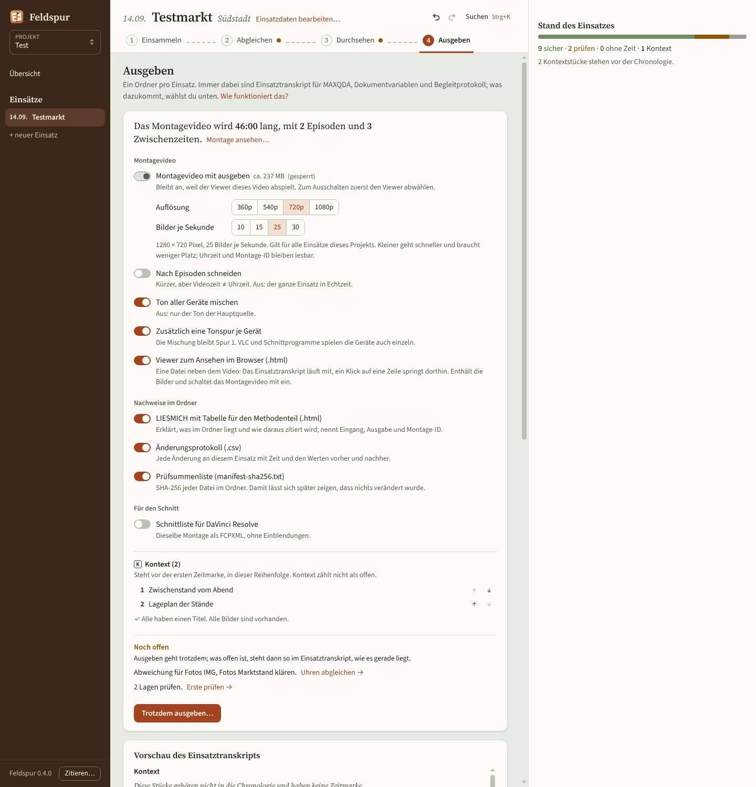
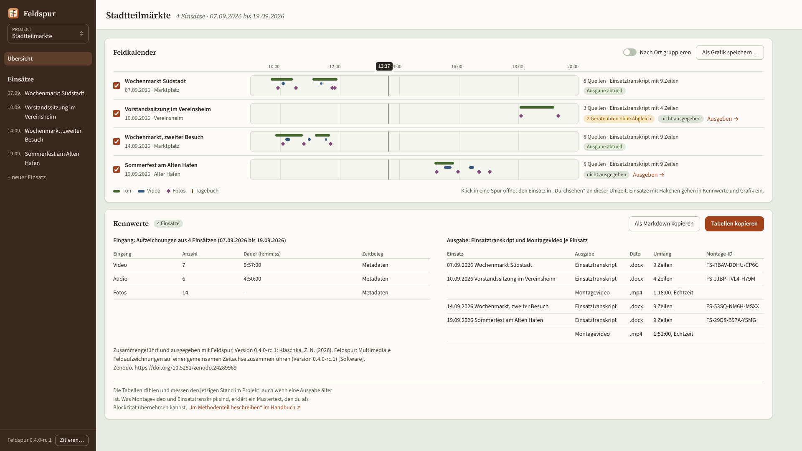

## Ausgeben {#sec-ausgeben}

Im letzten Schritt schreibt Feldspur mit **Ausgeben…** einen **Ordner pro Einsatz** in den Ordner, den du wählst. Er
heißt nach Datum und Titel, etwa `Feldtag_2026-09-14_Wochenmarkt`; gibt es dort schon einen gleichnamigen Ordner eines
anderen Einsatzes, hängt Feldspur eine Nummer an. Einsatztranskript, Dokumentvariablen und Begleitprotokoll sind immer
dabei. Was dazukommt, wählst du mit Schaltern in drei Gruppen: **Montagevideo** (Video, Ton und Viewer), **Nachweise
im Ordner** (LIESMICH, Änderungsprotokoll, Prüfsummenliste) und **Für den Schnitt** (Schnittliste). Ist vorher noch
etwas offen, etwa eine Uhr ohne Abgleich, heißt der Knopf **Trotzdem ausgeben…**, und unter **Noch offen** stehen
Links dorthin.

Den Stand der letzten Ausgabe merkt sich Feldspur in der Projektdatei. Oben im Schritt steht, wann und wohin
ausgegeben wurde und ob die Ausgabe noch passt:

- **Aktuell** (direkt nach der Ausgabe **Fertig**): Einsatz, Originale und Einstellungen sind genau wie bei der
  Ausgabe. Eine Karte nennt **Zeitraum**, **Quellen**, die Zeilen im **Einsatztranskript** und die volle
  **Montage-ID**. **Im Viewer ansehen** öffnet den Viewer im Browser (wenn er mit ausgegeben wurde), **Im Ordner
  zeigen** den Ausgabeordner. Die einzelnen Dateien klappt ein Link auf, etwa **8 Dateien anzeigen**.
- **Veraltet**: Seitdem hat sich etwas geändert. Darunter steht, was: der Einsatz selbst (Zeiten, Mitschrift, Tagebuch,
  Episoden, Angaben), neue oder entfernte Quellen, veränderte oder fehlende Originale (mit Kurzzeichen) oder andere
  Einstellungen als damals. Nimmst du die Änderung zurück, ist die Ausgabe wieder aktuell.
- Fehlen Dateien im **Ausgabeordner**, sind sie in der Dateiliste durchgestrichen. Fehlen alle, wurde der Ordner
  vermutlich verschoben, umbenannt oder gelöscht.

{#fig-ausgeben-veraltet}

**Erneut ausgeben** rechnet nur das Geänderte neu und schreibt ohne Nachfrage in den Ordner der letzten Ausgabe. Für
einen anderen Ordner gibt es **In anderen Ordner ausgeben…**. Ist eine Datei der letzten Ausgabe noch in Word, Excel
oder MAXQDA geöffnet, meldet Feldspur das gleich zu Beginn. Im Zweifel zeigt Feldspur lieber einmal zu oft „Veraltet“
als eine alte Ausgabe, die als aktuell gilt.

Jede Ausgabe beginnt, gleich nach der Wahl des Ordners, mit der Prüfung der Originale gegen ihre Prüfsumme
(@sec-originale). Bei großen Einsätzen dauert das einige Minuten; **Abbrechen** geht auch hier. Ist alles da und
unverändert, läuft die Ausgabe durch. Sonst hält sie an, bevor etwas geschrieben ist:

- **Fehlt** eine Datei, die die Ausgabe braucht, geht es erst nach dem Neu-Verknüpfen weiter. Gebraucht werden Fotos
  und Tagebuchseiten (für das Einsatztranskript) und, mit Montagevideo, alle Ton- und Videoaufnahmen.
- **Verändert** ist eine Datei, wenn sie nicht mehr dieselbe ist wie beim Einsammeln. Mit **Trotzdem ausgeben**
  geht es bewusst weiter; das Begleitprotokoll nennt weiter die Prüfsumme vom Einsammeln. Ebenso bei fehlenden
  Dateien, die diese Ausgabe nicht braucht (z. B. Ton ohne Montagevideo).

{#fig-ausgeben}

### Einsatztranskript (.docx)

Das **Einsatztranskript** ist das Dokument für MAXQDA. Jede Zeile beginnt mit einer Zeitmarke im Format
`#hh:mm:ss-z#`, die auf die passende Stelle im Montagevideo zeigt, und nennt die Uhrzeit dahinter. Dazu kommen
Mitschrift, Fotos und Ausschnitte aus den Tagebuchseiten. Im Kopf stehen die Einsatzdaten und die **Montage-ID**.

Gibt es Kontext (@sec-kontext), steht er vor der ersten Zeitmarke in einem Abschnitt **Kontext**, jedes Stück mit
Titel, Fundstelle, Bild und Text. Die Zeitmarken beginnen danach unter **Chronologie**. Ohne Zeitmarke verknüpft
MAXQDA den Kontext mit keiner Stelle im Video; codieren lässt er sich wie jeder andere Text. Die Reihenfolge legst du
in der Karte **Kontext** links fest.

### Montagevideo (.mp4)

Das **Montagevideo** legt Bild und Ton aller Aufnahmen des Einsatzes auf die gemeinsame Zeitachse. Es zeigt die
Uhrzeit, die gerade laufenden Videos (bis zu vier nebeneinander) mit Kurzzeichen, Datei und Stelle im Original, die
laufenden Tonquellen und die Montage-ID (@sec-montage-id). Fotos und Tagebuch stehen im Einsatztranskript und fehlen
deshalb im Video.

Einsatztranskript und Montagevideo gehören zusammen: **Erst beide zusammen** geben das Material eines Einsatzes
vollständig und zeitlich zugeordnet wieder. Das Einsatztranskript enthält, was als Text vorliegt, das Montagevideo
Bild und Ton auch dort, wo nichts mitgeschrieben ist. Was sich sehen oder hören, aber schwer in Worte fassen lässt,
codierst du direkt im Video. In der Multispecies-Ethnografie ist das häufig so, etwa beim Verhalten nichtmenschlicher
Tiere.

Optionen:

- **Montagevideo mit ausgeben** (Standard): Ist der Schalter aus, entstehen nur Einsatztranskript, Dokumentvariablen
  und Begleitprotokoll. Dahinter steht, wie groß das Video ungefähr wird, etwa „ca. 2,1 GB“; mit jeder Ausgabe wird
  die Schätzung genauer.
- **Auflösung** und **Bilder je Sekunde**: Standard ist 720p (1280 × 720 Pixel) mit 25 Bildern je Sekunde. Mit
  360p oder 540p und 10 oder 15 Bildern je Sekunde geht die Ausgabe schneller, und das Video wird kleiner; 1080p
  mit 30 Bildern zeigt mehr Einzelheiten und braucht länger. Uhrzeit, Herkunft und Montage-ID bleiben in jeder
  Auflösung lesbar. Wenige Bilder je Sekunde ruckeln bei schnellen Bewegungen, etwa wenn du Tierverhalten im Video
  codierst. Die Wahl gilt für alle Einsätze des Projekts und steht in der Projektdatei. Die Montage-ID ändert sie
  nicht, denn das Video zeigt dasselbe, nur feiner oder gröber; die LIESMICH nennt Auflösung und Bildrate hinter dem
  Video. Eine frühere Ausgabe in einem anderen Format gilt danach als veraltet, mit dem Grund „andere Einstellungen“.
- Standardmäßig läuft das Video **in Echtzeit** am Stück: Videozeit gleich Uhrzeit ab Beginn.
- **Nach Episoden schneiden** (nur wenn unter "Durchsehen" Episoden eingeschaltet sind): Episoden in voller Länge,
  Zeit dazwischen als kurze Tafel. Das Video wird kürzer, die Videozeit entspricht dann aber nicht mehr der Uhrzeit.
  Was in der Zeit dazwischen entstand (Mitschrift, Fotos, Tagebuch), steht im Einsatztranskript an der Tafel.
- **Ton aller Geräte mischen**: sonst nur die Haupttonquelle.
- **Zusätzlich eine Tonspur je Gerät** (Standard): Die Mischung (oder Haupttonquelle) bleibt Tonspur 1; MAXQDA und
  jeder Player spielen sie wie bisher. Dahinter folgt für jedes Gerät mit Ton eine eigene Spur mit dem Namen des
  Geräts. In VLC (Audio › Audiospur), QuickTime, einem Schnittprogramm oder im Viewer hörst du so ein Gerät allein,
  etwa wenn eine Stimme im Rekorder untergeht und das Handy näher dran war.
- **Schnittliste für DaVinci Resolve** (Datei › Importieren › Timeline), falls du die Montage dort weiterbearbeiten
  willst.
- **Viewer zum Ansehen im Browser** (Standard): eine HTML-Datei, in der du Video und Einsatztranskript zusammen
  ansiehst (@sec-viewer). Weil der Viewer das Montagevideo abspielt, bleibt **Montagevideo mit ausgeben** deshalb an,
  solange er gewählt ist.
- **LIESMICH mit Tabelle für den Methodenteil** (@sec-liesmich), **Änderungsprotokoll**
  (@sec-aenderungsprotokoll-ausgabe) und **Prüfsummenliste** (@sec-pruefsummenliste), alle drei Standard.

Mit **Montage ansehen…** spielst du dieselbe Montage vorher direkt aus den Originalen ab, ohne sie zu rechnen.

Ein Montagevideo in Echtzeit rechnet bei einem langen Einsatz eine Weile. Der Rechner geht dabei nicht in den
Ruhezustand, und du kannst das Fenster in den Hintergrund legen; einen Mac lässt du besser aufgeklappt. Mit
**Abbrechen** neben dem Fortschrittsbalken hältst du die Ausgabe an. Sie gilt dann nicht als fertig, auch eine frühere
Ausgabe im selben Ordner nicht mehr. Fertige Videoabschnitte bleiben 30 Tage im Zwischenspeicher, der nächste Versuch
geht deshalb schneller.

### Montage-ID {#sec-montage-id}

Die **Montage-ID** ist eine Kennung wie `FS-7KQ2-M9XD-3F8A`. Sie steht im Kopf des Einsatztranskripts, im Viewer und
in den Dokumentvariablen. An ihr erkennst du, welches Video zu welchem Einsatztranskript gehört und welche Fassung
du vor dir hast.

Feldspur vergibt sie nicht fortlaufend, sondern **errechnet** sie aus dem Stand des Einsatzes. Derselbe Stand ergibt
deshalb immer dieselbe ID, auch nach einem Neustart, auf einem anderen Rechner oder in einer späteren Ausgabe. Sie
besteht aus zwei Teilen:

| Teil | im Beispiel | beschreibt |
|:--|:-----|:----|
| **Montage** | `FS-7KQ2-M9XD` (die ersten beiden Blöcke) | welche Aufnahmen wann laufen |
| **Text** | `3F8A` (der dritte Block) | was im Einsatztranskript steht |

: Die Teile der Montage-ID {#tbl-montage-id-teile}

In die **Montage** gehen der Einsatz (seine interne Kennung, nicht Titel oder Datum), die Art und Länge der Montage
und jede Quelle auf der Zeitachse ein, mit der Prüfsumme ihrer Originaldatei und ihrem Beginn auf die Millisekunde.
In den **Text** geht ein, was im Einsatztranskript steht: der Kopf, jede Zeile mit ihrer Zeitmarke, die
Bildausschnitte und der Kontext.

Im **Montagevideo** stehen oben rechts nur die ersten beiden Blöcke, also `FS-7KQ2-M9XD`. Das Video enthält keinen
Text. Es bleibt deshalb gültig, wenn du nur weiterschreibst, und muss dafür nicht neu gerechnet werden.

Beide Teile sind Fingerabdrücke (SHA-1), gekürzt auf acht bzw. vier Zeichen, ohne die leicht verwechselbaren 0, O, 1
und I. Aus den Zeichen selbst lässt sich nichts zurückrechnen. Lesen lässt sich die ID im **Vergleich** zweier
Ausgaben:

| Vergleich zweier IDs | Was das heißt |
|:---|:-------|
| alle drei Blöcke gleich | Derselbe Stand. Zeitmarken und Wortlaut stimmen überein. |
| Montage gleich, Text anders | Gleiches Video, gleiche Zeitmarken. Geändert hat sich nur etwas im Einsatztranskript: Mitschrift, Tagebuchtext, Kontext oder Angaben im Kopf. |
| Montage anders | Auf der Zeitachse hat sich etwas geändert (oder es ist ein anderer Einsatz). Zeitmarken können auf andere Stellen zeigen, und das Video gehört nicht mehr dazu. Der Textblock ändert sich dabei in aller Regel mit. |

: Zwei Montage-IDs vergleichen {#tbl-montage-id-lesen}

+-------------------------+--------------------------------------------------------------------------------------+
| Was sich ändert         | Wann                                                                                 |
+:========================+:=====================================================================================+
| **Montage**             | - eine Quelle kommt dazu, fällt weg oder wird Kontext                                |
| (Blöcke 1 und 2)        | - eine Quelle liegt auf der Zeitachse anders (neuer Abgleich, andere Uhrkorrektur,   |
|                         |   Uhrzeit von Hand)                                                                  |
|                         | - eine Tagebuchseite bekommt ihre erste oder eine frühere Randnotiz                  |
|                         | - du schaltest Episoden ein oder aus oder gibst anders aus (in Echtzeit, nach        |
|                         |   Episoden)                                                                          |
|                         | - die Länge der Montage ändert sich                                                  |
|                         | - dieselben Dateien liegen in einem neuen Einsatz oder Projekt                       |
+-------------------------+--------------------------------------------------------------------------------------+
| **nur der Text**        | - du schreibst mit oder korrigierst eine Mitschrift                                  |
| (Block 3)               | - du tippst Tagebuchtext ab oder änderst ihn                                         |
|                         | - du änderst Einsatzdaten, weitere Angaben, Personen oder Kurzzeichen                |
|                         | - du ergänzt, änderst oder sortierst Kontext um                                      |
+-------------------------+--------------------------------------------------------------------------------------+
| **nichts**              | - du gibst ohne Änderung noch einmal aus                                             |
|                         | - du gibst mit anderen Optionen für Ton, Viewer oder Schnittliste aus                |
|                         | - du änderst Lautstärken                                                             |
|                         | - du verschiebst, sicherst oder stellst das Projekt wieder her                       |
+-------------------------+--------------------------------------------------------------------------------------+

: Wovon die Montage-ID abhängt {#tbl-montage-id}

Die ID ist an beiden Stellen bewusst streng. Schon ein zusätzliches Foto oder eine um eine Millisekunde verschobene
Aufnahme ergibt eine neue Montage, schon ein korrigierter Tippfehler einen neuen Textblock.

::: {.callout-note}
Bis Version 0.2 bestand die Montage-ID nur aus den ersten beiden Blöcken. Die sind geblieben, wie sie waren: Ein
älteres Montagevideo passt weiter zu einer neuen Ausgabe desselben Stands. Eine ältere Ausgabe zeigt Feldspur einmal
als **Veraltet** an, weil dem Einsatztranskript der dritte Block fehlt.
:::

### Viewer (.html) {#sec-viewer}

Der **Viewer** ist eine einzelne HTML-Datei neben dem Montagevideo. Du öffnest sie per Doppelklick in Chrome, Edge,
Firefox oder Safari; MAXQDA oder Feldspur braucht dafür niemand. Willst du einen Einsatz weitergeben, etwa an die
Betreuung oder an eine Interpretationsgruppe, kopierst du den ganzen Ordner.

{#fig-viewer}

Links stehen das Video, die Steuerleiste und die Zeitleiste, rechts das Einsatztranskript. Die Zeile, die gerade
läuft, ist getönt.

- Ein **Klick** auf eine Zeile springt im Video an diese Stelle.
- Mit dem Schalter **Text läuft mit** (Taste [T]{.kbd}) folgt der Text dem Video. Scrollst du selbst, hält er an;
  **Zur aktuellen Stelle** bringt dich zurück.
- Die **Zeitleiste** zeigt Episoden, Zwischenzeiten, Fotos, Tagebuch und je Gerät eine Spur. Das **Mausrad** über der
  Zeitleiste zoomt, ebenso [+]{.kbd} und [−]{.kbd}; mit [Umschalt]{.kbd} und Mausrad verschiebst du den Ausschnitt.
  **Alles** zeigt wieder den ganzen Einsatz.
- Dazu kommen die **Suche** und das Fenster **Kontext** (@sec-kontext). Unter **Ansicht** blendest du Zeilenarten
  ein oder aus, änderst die Schriftgröße, wählst hell oder dunkel und legst fest, ob am Rand Uhrzeit, Videozeit oder
  `#Marke#` steht.
- **Stelle kopieren** legt Einsatz, Datum, Uhrzeit, Zeitmarke und Montage-ID in die Zwischenablage.
- Ins **Vollbild** kommst du mit der Taste [F]{.kbd} oder per Doppelklick ins Video. Alle Tasten zeigt die Taste
  [?]{.kbd}.

Findet der Viewer das Video nicht, weil es fehlt oder anders heißt, bietet er **Videodatei wählen…** an. Das
Einsatztranskript bleibt auch ohne Video lesbar.

Zu hören ist zunächst die Mischung. Hat das Video eine Tonspur je Gerät, öffnet **Erweiterte Tonspurkontrolle** einen
kurzen Assistenten, mit dem du einzelne Geräte hörst. Safari spielt die Tonspuren selbst. Chrome, Edge und Firefox
brauchen dafür einmal die Videodatei: Zieh sie in den Assistenten oder wähle **Video freigeben…**. Chrome und Edge
merken sich die Freigabe (**Erneut freigeben**), in Firefox wählst du das Video jedes Mal neu.

Danach hat jede Gerätespur die Knöpfe **S** (nur diese Spur hören) und **M** (stumm). Mit den Tasten [1]{.kbd} bis
[9]{.kbd} hörst du nur ein Gerät, mit [0]{.kbd} oder **Alle hören** wieder die Mischung. Bei einem anderen Tempo als
1× ist immer die Mischung zu hören.

Der Viewer lädt nichts aus dem Netz und schickt nichts weg. Schriften, Bilder und Programm stecken in der Datei; sie
wächst deshalb mit jedem Foto und jeder Tagebuchseite um grob 150 KB.

### Dokumentvariablen (.xlsx)

Die Datei `…_Variablen.xlsx` enthält die Angaben zum Einsatz als **Dokumentvariablen** für MAXQDA: Einsatz, Datum,
Ort, Zeitzone, Forschende, Geräte, Referenzuhr, Zahl der Quellen, Beginn und Ende, Videolänge, Art der Montage,
Montage-ID und deine **weiteren Angaben** aus den Einsatzdaten (z. B. DOI). So kannst du in MAXQDA später nach Ort,
Datum oder Gerät filtern und vergleichen.

Die ersten beiden Spalten sind Dokumentgruppe und Dokumentname (der Dateiname des Einsatztranskripts ohne Endung).
Liegt das Dokument in MAXQDA in einer Dokumentgruppe, trag deren Namen vorher in der Spalte "Dokumentgruppe" ein,
sonst findet MAXQDA das Dokument nicht.

### Begleitprotokoll (.csv)

Das **Begleitprotokoll** hält für jede Datei Herkunft und Zeitnachweis fest: Kurzzeichen, Originaldatei, Prüfsumme,
Gerät, verwendeter Zeitbeleg und Uhrkorrektur, bei Kontext auch **Rolle**, **Kontext** und **Kontext entstanden**. So
bleibt nachvollziehbar, worauf jede Lage im Einsatztranskript beruht, und das Material lässt sich sauber archivieren.

### LIESMICH (.html) {#sec-liesmich}

Die Datei `LIESMICH.html` ist für Menschen gedacht, die den Ordner später öffnen, auch für dich selbst in ein paar
Jahren. Sie lässt sich in jedem Browser lesen und drucken. Darin steht:

- welcher Einsatz das ist, mit der ganzen Montage-ID,
- was im Ordner liegt und wozu jede Datei dient,
- wie Einsatztranskript, Zeitmarken und Montagevideo zusammengehören,
- wie aus dieser Ausgabe zitiert wird (@sec-stelle-zitieren),
- die Tabelle für den Methodenteil dieses Einsatzes (@sec-methodenteil), darunter Feldspur mit Version und DOI.

Die Tabelle steht dort, weil sie die Montage-ID trägt: So bleibt sie bei genau der Fassung, die sie beschreibt.
Einsatztranskript und Montagevideo sind auch ohne die LIESMICH vollständig und zitierfähig.

### Änderungsprotokoll (.csv) {#sec-aenderungsprotokoll-ausgabe}

`…_Aenderungsprotokoll.csv` führt jede Änderung an diesem Einsatz mit Zeit (UTC), Aktion und den Werten vorher und
nachher, so wie im Projektmenü unter **Änderungsprotokoll…** (@sec-erste-schritte). Darin steht nur, was diesen
Einsatz betrifft, auch gelöschte Quellen; andere Einsätze und Projektweites wie Personen bleiben draußen. Das
Protokoll hält den Stand beim Start der Ausgabe fest.

### Prüfsummenliste (manifest-sha256.txt) {#sec-pruefsummenliste}

Zuletzt schreibt Feldspur `manifest-sha256.txt` mit der SHA-256-Prüfsumme jeder anderen Datei im Ordner, auch von
Montagevideo und LIESMICH. Damit lässt sich später zeigen, dass der Ordner noch genau so ist, wie Feldspur ihn
ausgegeben hat. Das Format ist das von `sha256sum`: Im Ordner prüft `sha256sum -c manifest-sha256.txt` jede Datei
(unter macOS `shasum -a 256 -c manifest-sha256.txt`). Die Prüfsummen der Originaldateien stehen weiter im
Begleitprotokoll.

### In MAXQDA

Lies das Einsatztranskript in MAXQDA als Transkript mit Zeitmarken ein und ordne ihm das Montagevideo als Mediendatei
zu. Danach springt ein Klick auf eine Zeitmarke an die passende Stelle im Video. Codiert wird wie gewohnt, im Text
des Einsatztranskripts und, wo nichts verschriftlicht ist, direkt in Abschnitten des Videos. Ein Einsatz ergibt genau
ein MAXQDA-Dokument. Die Dokumentvariablen liest du danach über **Variablen › Dokumentvariablen importieren** aus der
.xlsx-Datei ein; mehrere Einsätze kannst du dafür auch in einer Tabelle untereinander kopieren.

### Aus der Ausgabe zitieren {#sec-stelle-zitieren}

Einsatztranskript und Montagevideo beruhen auf den Aufzeichnungen aus dem Feld, sind aber etwas Eigenes: In ihnen
stecken deine Entscheidungen. Welche Uhr gilt, was nebeneinanderliegt, was du wie verschriftlicht hast. Eine einzelne
Videodatei steht für sich und ohne Zusammenhang da. Meine Empfehlung deshalb: Zitiere eine Stelle **aus der Ausgabe**,
nicht aus der Originaldatei dahinter und auch nicht aus dem Projekt in Feldspur.

Das Projekt ist ein Arbeitsstand und ändert sich mit jedem Handgriff. Die Ausgabe ist das, was du festhalten,
archivieren und weitergeben kannst. Fest ist sie allerdings erst, wenn du sie festhältst, denn **Erneut ausgeben**
überschreibt die Dateien im selben Ordner und räumt Dateien der letzten Ausgabe weg, die diesmal nicht entstehen
(etwa ein abgewähltes Montagevideo). So gehst du vor:

1. Gib den Einsatz aus, sobald Abgleich und Mitschrift für deine Arbeit stehen, und prüfe, dass der Stand **Aktuell**
   ist.
2. Sichere den Ausgabeordner als Ganzes und unverändert. Die Prüfsummenliste zeigt später, dass nichts verändert wurde
   (@sec-pruefsummenliste). Am besten in einem Archiv oder Repositorium, das Fassungen festhält und eine dauerhafte
   Adresse vergibt, etwa eine DOI.
3. Zitiere aus genau dieser Fassung. Im Viewer legt **Stelle kopieren** die Angabe in die Zwischenablage:
   Einsatz, Datum, Uhrzeit, Zeitmarke und Montage-ID.
4. Nenne die **ganze Montage-ID** mit allen drei Blöcken. Sie legt fest, welche Fassung du meinst, samt Wortlaut
   (@sec-montage-id). Die Adresse im Archiv sagt dazu, wo diese Fassung liegt.

Eine Angabe kann dann so aussehen (die Werte sind erfunden):

> Testperson A (2026): Feldtag Testmarkt, 14.09.2026. Einsatztranskript und Montagevideo FS-7KQ2-M9XD-3F8A,
> #00:05:02-0# (10:07:02 Uhr).

Im Methodenteil erklärst du einmal, was ein Montagevideo und ein Einsatztranskript sind und womit sie entstanden sind
(@sec-methodenteil, Feldspur mit Version, @sec-zitieren). Der Weg zurück zum Original bleibt nachvollziehbar: Das
Begleitprotokoll nennt für jede Datei Herkunft, Prüfsumme und den Zeitbeleg, auf dem ihre Lage beruht.

Änderst du nach dem Zitieren noch etwas und gibst erneut aus, dann sichere die neue Ausgabe als eigene Fassung und
vergleiche die Montage-IDs (@tbl-montage-id-lesen). Ist nur der dritte Block anders, gelten deine Zeitmarken
weiter, und du prüfst höchstens den Wortlaut der zitierten Stellen. Sind die ersten beiden Blöcke anders, können
sich die Stellen verschoben haben. Dann prüfst du die zitierten Zeitmarken anhand der Uhrzeit nach. Wer deine Arbeit
liest, erkennt an der ID ebenso, ob die vorliegende Fassung die zitierte ist.

### Im Methodenteil beschreiben {#sec-methodenteil}

Wer aus der Ausgabe zitiert, muss einmal erklären, was das für ein Artefakt ist und woraus es besteht. Das
Begleitprotokoll ist dafür zu fein: Es führt jede Datei einzeln. Für einen einzelnen Einsatz stehen die verdichteten
Tabellen in der LIESMICH seines Ausgabeordners (@sec-liesmich). Für mehrere Einsätze zusammen gibt es die
**Übersicht**. Du findest sie in der linken Leiste über den Einsätzen; sie gehört zum Projekt, nicht zu einem
einzelnen Einsatz.

{#fig-uebersicht}

Oben steht der **Feldkalender**, je Einsatz eine Zeile: Datum, Titel und Ort, die Zahl der Quellen und der Zeilen im
Einsatztranskript, Geräteuhren ohne Abgleich und der Stand der Ausgabe. Passen alle Ausgaben zum Stand, steht neben
dem Projektnamen **Alle Ausgaben aktuell**. In der Mitte jeder Zeile liegt der Einsatz auf einer Uhrzeit-Achse, die
für alle Einsätze gleich ist: Ton und Video als Balken, Fotos als Rauten, Tagebucheinträge als Striche zur Notierzeit.
Untereinander sieht man so, was ein einzelner Einsatz verbirgt, etwa wiederkehrende Uhrzeiten, dichte und dünne Phasen
oder Einsätze ohne Ton.

Die Achse reicht vom Mittag des Vortags bis zum Mittag des Folgetags. Liegt eine Quelle weit davon weg, etwa weil die
Uhr einer Kamera auf 2019 zurückgesprungen ist, fehlt sie im Feldkalender. Die Zeile sagt dann **1 Quelle weit weg
vom Datum**, und **Abgleichen** führt zum Einsatz.

Ein Klick auf den Titel öffnet den Einsatz, ein Klick in die Achse öffnet ihn in Durchsehen an dieser Uhrzeit. Mit
**Nach Ort gruppieren** stehen Einsätze am selben Ort zusammen, sonst gilt die Folge nach Datum. **Als Grafik
speichern…** schreibt die gewählten Einsätze als SVG-Grafik, etwa für den Methodenteil oder einen Vortrag; sie lässt
sich in Word, LibreOffice, Inkscape oder Affinity einfügen und weiter bearbeiten.

Darunter stehen die **Kennwerte** als zwei Tabellen zum Kopieren:

- **Eingang**: die Aufzeichnungen je Art und Gerät, mit Anzahl, Dauer (bei Ton und Video) und Zeitbeleg. Wurde die
  Uhr eines Geräts korrigiert, steht die Korrektur dabei. Über mehrere Einsätze steht je Art eine Zeile, und die
  Spalte **Gerät** fällt weg: Ob es in zwei Einsätzen dasselbe Gerät war, weiß Feldspur nicht.
- **Ausgabe**: je Einsatz das Einsatztranskript mit der Zahl seiner Zeilen und der ganzen Montage-ID, dazu das
  Montagevideo mit Länge und Art der Montage (nur, wenn du es zuletzt mit ausgegeben hast).

Darunter steht Feldspur mit Version und DOI. Die Tabellen fassen alle Einsätze zusammen, vor denen ein Häkchen
steht; abgewählte Einsätze fehlen auch in der gespeicherten Grafik. **Tabellen kopieren** legt die Tabellen so in die
Zwischenablage, dass Word, LibreOffice und Pages echte Tabellen einfügen, **Als Markdown kopieren** als Text. Spalten
und Wortlaut passt du danach in deinem Dokument an.

Feldspur zählt und misst hier nur. In der Übersicht steht „412 Zeilen“, aber kein Urteil darüber, ob das viel oder
genug ist. Das bleibt bei dir. Farbig sind deshalb nur Zustände, die Feldspur ohnehin meldet, etwa eine veraltete
Ausgabe oder eine Geräteuhr ohne Abgleich, nie eine Menge.

Die Kennwerte beschreiben den Stand im Projekt. An jedem Einsatz steht, ob er so schon als Ausgabe vorliegt:
**Ausgabe aktuell**, **Ausgabe veraltet**, **Ausgabe fehlt im Ordner** oder **nicht ausgegeben**. Steht dort nicht
„aktuell“, führt **Ausgeben** (bei einer früheren Ausgabe **Erneut ausgeben**) direkt in den Schritt Ausgeben dieses
Einsatzes. Gib den Einsatz aus, bevor du die Kennwerte übernimmst, sonst passen Montage-ID und Umfang nicht zu den
Dateien, aus denen du zitierst.

So kann das Ergebnis für zwei Einsätze aussehen (die Werte sind erfunden). Bei einem einzelnen Einsatz, etwa in der
LIESMICH, kommt in der Eingangstabelle die Spalte **Gerät** mit den Namen der Geräte dazu.

| Eingang | Anzahl | Dauer (h:mm:ss) | Zeitbeleg |
|:---|:---|:---|:-------|
| Video | 214 | 3:31:00 | Metadaten; Uhr korrigiert (+0:18 bis +0:42) |
| Audio | 11 | 6:05:00 | angesagte Uhrzeit (2), Folgeaufnahme (9) |
| Fotos | 37 | – | Metadaten |
| Tagebuch | 58 Einträge, 7 Dateien | – | notierte Uhrzeit |

: Eingang: Aufzeichnungen aus 2 Einsätzen (14.09.2026 bis 15.09.2026) {#tbl-methodenteil-eingang}

| Einsatz | Ausgabe | Datei | Umfang | Montage-ID |
|:---|:---|:---|:---|:---|
| 14.09.2026 Testmarkt | Einsatztranskript | .docx | 412 Zeilen | FS-7KQ2-M9XD-3F8A |
| | Montagevideo | .mp4 | 3:10:00, Echtzeit | |
| 15.09.2026 Testmarkt, zweiter Tag | Einsatztranskript | .docx | 388 Zeilen | FS-2VHN-C4TW-8RJE |
| | Montagevideo | .mp4 | 2:55:00, Echtzeit | |

: Ausgabe: Einsatztranskript und Montagevideo je Einsatz {#tbl-methodenteil-ausgabe}

Was fehlt, ist die Erklärung in Worten. Den folgenden Mustertext kannst du als Blockzitat übernehmen (mit diesem
Handbuch als Quelle, @sec-zitieren) oder in eigenen Worten nacherzählen:

> Die Aufzeichnungen eines Feldeinsatzes (Video, Ton, Fotos, Feldtagebuch) werden in Feldspur anhand ihrer Uhrzeiten
> auf eine gemeinsame Zeitachse gelegt. Die Uhren der Geräte werden dafür gegen eine Referenzuhr abgeglichen; worauf
> die Lage jeder Datei beruht, hält ein Begleitprotokoll fest. Aus der Zeitachse entstehen zwei Ausgaben, die
> zusammengehören. Das Einsatztranskript führt Mitschrift, Tagebucheinträge und Fotos in zeitlicher Folge, jede Zeile
> mit Uhrzeit und Zeitmarke. Das Montagevideo zeigt die Aufnahmen aller Geräte in Echtzeit, gleichzeitige
> nebeneinander; die Zeitmarken des Einsatztranskripts zeigen auf Stellen in diesem Video. Beide sind abgeleitete
> Artefakte: In ihnen stecken Entscheidungen der Forschenden, etwa welche Uhr gilt und was wie verschriftlicht wurde.
> Zitiert wird deshalb aus dieser Ausgabe. Die Montage-ID bezeichnet dabei die Fassung, samt Wortlaut.

Schneidest du nach Episoden, passt der Satz zum Montagevideo nicht: Dann laufen nur die Episoden in voller Länge, und
die Zeit dazwischen wird zu einer kurzen Tafel.
