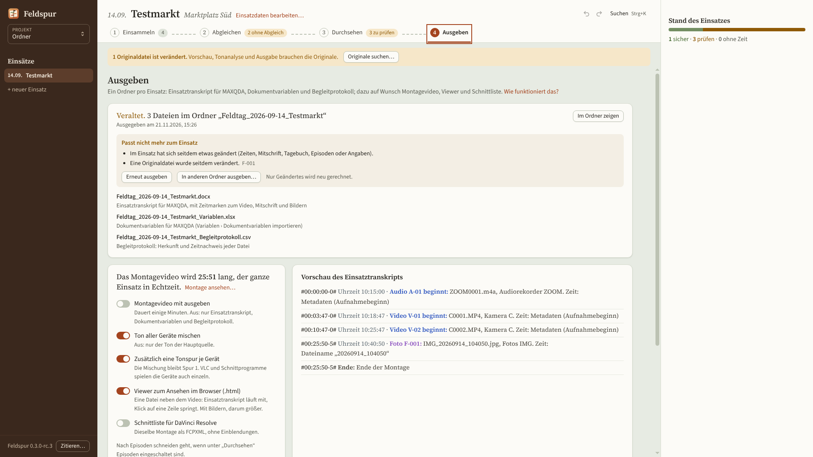

## Ausgeben {#sec-ausgeben}

Im letzten Schritt schreibt Feldspur einen **Ordner pro Einsatz** mit drei Teilen. Ist vorher noch etwas offen, etwa
eine Uhr ohne Abgleich, steht das unter **Noch offen** mit Links dorthin; der Knopf heißt dann **Trotzdem ausgeben…**.

Den Stand der letzten Ausgabe merkt sich Feldspur in der Projektdatei, auch über einen Neustart hinweg. Oben im Schritt
steht dann, wann und wohin ausgegeben wurde, und ob die Ausgabe noch passt:

- **Aktuell**: Einsatz, Originale und Einstellungen sind genau wie bei der Ausgabe.
- **Veraltet**: Seitdem hat sich etwas geändert. Darunter steht, was: der Einsatz selbst (Zeiten, Mitschrift, Tagebuch,
  Episoden, Angaben), neue oder entfernte Quellen, veränderte oder fehlende Originale (mit Kurzzeichen) oder andere
  Einstellungen als damals, z. B. jetzt mit Montagevideo. Machst du eine Änderung rückgängig, ist die Ausgabe wieder
  aktuell.
- Fehlen Dateien im **Ausgabeordner**, sind sie durchgestrichen.

{#fig-ausgeben-veraltet}

**Erneut ausgeben…** rechnet nur das Geänderte neu und geht ohne Nachfrage in den Ordner der letzten Ausgabe (der
Knopf nennt ihn als Hinweis). Für einen anderen Ordner gibt es **In anderen Ordner ausgeben…**; der Ordnerdialog
beginnt dann beim bisherigen Ordner. Ist eine Datei der letzten Ausgabe noch in Word, Excel oder MAXQDA geöffnet, meldet
Feldspur das gleich zu Beginn („… ist noch in einem anderen Programm geöffnet“) und nicht erst nach dem Video. Feldspur ist dabei vorsichtig: Lieber einmal zu oft „Veraltet“ als
eine alte Ausgabe, die als aktuell gilt.

Vor jeder Ausgabe prüft Feldspur die Originale mit ihrer Prüfsumme (@sec-originale). Ist alles da und unverändert,
geht es gleich weiter. Sonst steht da, was auffällt:

- **Fehlt** eine Datei, die die Ausgabe braucht, geht es erst nach dem Neu-Verknüpfen weiter. Gebraucht werden Fotos
  und Tagebuchseiten (für das Einsatztranskript) und, mit Montagevideo, alle Ton- und Videoaufnahmen.
- **Verändert** ist eine Datei, wenn sie nicht mehr dieselbe ist wie beim Einsammeln. Mit **Trotzdem ausgeben**
  geht es bewusst weiter; das Begleitprotokoll nennt weiter die Prüfsumme vom Einsammeln. Ebenso bei fehlenden
  Dateien, die diese Ausgabe nicht braucht (z. B. Ton ohne Montagevideo).

{#fig-ausgeben}

### Einsatztranskript (.docx)

Das **Einsatztranskript** (bis Version 0.2 "Zeitgerüst") ist das Dokument für MAXQDA. Jede Zeile beginnt mit einer Zeitmarke im Format `#hh:mm:ss-z#`, die
auf die passende Stelle im Montagevideo zeigt, und nennt die Uhrzeit dahinter. Dazu kommen Mitschrift, Fotos und
Ausschnitte aus den Tagebuchseiten, auch aus PDFs. Im Kopf stehen die Einsatzdaten und die **Montage-ID**. Zeilenumbrüche in einem abgetippten Tagebuchtext bleiben
erhalten; der Eintrag bleibt dabei ein Absatz mit einer einzigen Zeitmarke.

Gibt es Kontext (@sec-kontext), steht vor der ersten Zeitmarke ein Abschnitt **Kontext** mit allen Stücken ohne
Zeitmarke, jedes als "Kontext · Titel" mit Fundstelle, Bild und Text. Die Zeitmarken beginnen danach unter
**Chronologie**. Weil der Kontext keine Zeitmarke trägt, verknüpft MAXQDA ihn mit keiner Stelle im Video; codieren
lässt er sich wie jeder andere Text. Das Montagevideo bleibt unverändert. In der Karte **Kontext** links legst du die
Reihenfolge fest.

### Montagevideo (.mp4)

Das **Montagevideo** legt Bild und Ton aller Aufnahmen des Einsatzes auf die gemeinsame Zeitachse. Es zeigt die
Uhrzeit, die gerade laufenden Videos (bis zu vier nebeneinander) mit Kurzzeichen, Datei und Stelle im Original, die
laufenden Tonquellen und die Montage-ID. Fotos und Tagebuch stehen schon im Einsatztranskript und fehlen deshalb im Video.

Einsatztranskript und Montagevideo gehören zusammen: **Erst beide zusammen** geben das Material eines Einsatzes vollständig
und zeitlich zugeordnet wieder. Das Einsatztranskript enthält, was als Text vorliegt, dazu Fotos und Tagebuchausschnitte. Das
Montagevideo enthält Bild und Ton auch dort, wo nichts mitgeschrieben ist. Oft wird der Großteil im Einsatztranskript
codiert. Was sich sehen oder hören, aber schwer in Worte fassen lässt, codierst du direkt im Video. In der
Multispecies-Ethnografie ist das häufig so, etwa beim Verhalten nichtmenschlicher Tiere.

Optionen:

- Standardmäßig läuft das Video **in Echtzeit** am Stück: Videozeit gleich Uhrzeit ab Beginn.
- **Nach Episoden schneiden** (nur wenn unter "Durchsehen" Episoden eingeschaltet sind): Episoden in voller Länge,
  Zeit dazwischen als kurze Tafel. Das Video wird kürzer, die Videozeit entspricht dann aber nicht mehr der Uhrzeit.
- **Ton aller Geräte mischen**: sonst nur die Haupttonquelle.
- **Schnittliste für DaVinci Resolve** (Datei › Importieren › Timeline), falls du die Montage dort weiterbearbeiten
  willst.

Mit **Montage ansehen** spielst du dieselbe Montage vorher direkt aus den Originalen ab, ohne sie zu rechnen.

Ein Montagevideo in Echtzeit rechnet bei einem langen Feldtag eine Weile. Hast du dich bei den Optionen vertan, hältst
du die Ausgabe neben dem Fortschrittsbalken mit **Abbrechen** an. Die Ausgabe gilt dann nicht als fertig, auch eine
frühere Ausgabe im selben Ordner nicht mehr. Fertige Videoabschnitte bleiben im Zwischenspeicher, der nächste Versuch
geht deshalb schneller.

### Dokumentvariablen (.xlsx)

Die Datei `…_Variablen.xlsx` enthält die Angaben zum Einsatz als **Dokumentvariablen** für MAXQDA: Einsatz, Datum,
Ort, Zeitzone, Forschende, Geräte, Referenzuhr, Zahl der Quellen, Beginn und Ende, Videolänge, Art der Montage,
Montage-ID und deine **weiteren Angaben** aus den Einsatzdaten (z. B. DOI). So kannst du in MAXQDA später nach Ort,
Datum oder Gerät filtern und vergleichen.

Die ersten beiden Spalten sind Dokumentgruppe und Dokumentname. Der Dokumentname ist der Name, den MAXQDA dem
Einsatztranskript beim Import gibt (Dateiname ohne Endung). Liegt das Dokument in MAXQDA in einer Dokumentgruppe, trag
deren Namen vorher in der Spalte "Dokumentgruppe" ein, sonst findet MAXQDA das Dokument nicht.

### Begleitprotokoll (.csv)

Das **Begleitprotokoll** hält für jede Datei Herkunft und Zeitnachweis fest: Kurzzeichen, Originaldatei,
Prüfsumme, Gerät, verwendeter Zeitbeleg und Uhrkorrektur. Gibt es Kontext, kommen die Spalten **Rolle**, **Kontext** und
**Kontext entstanden** dazu, in den Dokumentvariablen die Zahl der **Kontextstücke**. So bleibt nachvollziehbar, worauf jede Lage im Einsatztranskript
beruht, und das Material lässt sich sauber archivieren.

### In MAXQDA

Lies das Einsatztranskript in MAXQDA als Transkript mit Zeitmarken ein und ordne ihm das Montagevideo als Mediendatei zu.
Danach springt ein Klick auf eine Zeitmarke an die passende Stelle im Video. Codiert wird wie gewohnt in MAXQDA,
im Text des Einsatztranskripts und, wo nichts verschriftlicht ist, direkt in Abschnitten des Videos.
Ein Einsatz ergibt genau ein MAXQDA-Dokument. Die Dokumentvariablen liest du danach über **Variablen ›
Dokumentvariablen importieren** aus der .xlsx-Datei ein; mehrere Einsätze kannst du dafür auch in einer Tabelle
untereinander kopieren.
