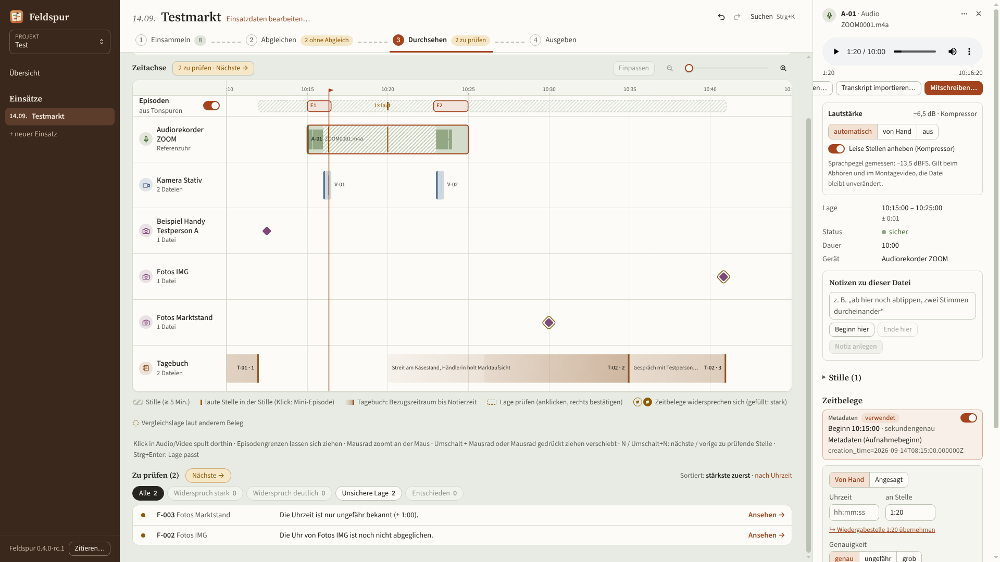

## Durchsehen {#sec-durchsehen}

Im Schritt **Durchsehen** liegt alles auf einer Zeitachse: eine Spur pro Gerät, darin die Quellen an ihrer Uhrzeit.

{#fig-durchsehen}

### Auf der Zeitachse arbeiten

- Ein **Klick** in eine Audio- oder Videospur spult dorthin; die laufenden Aufnahmen erscheinen in der Wiedergabe.
  Beim Abspielen läuft die Zeitachse mit.
- Das **Mausrad** zoomt an der Mausposition, mit **Umschalt** (oder waagerechtem Wischen) verschiebst du die Achse.
  Du kannst sie auch mit gedrückter **mittlerer Maustaste** (Mausrad drücken) ziehen.
  Regler und +/− zoomen um die Abspielposition.
- Ein Klick auf eine Quelle öffnet sie in der Detailleiste.
- Tagebuchbalken zeigen ihre Kurzform oder die erste Zeile, Clips zeigen ihre Mitschrift-Zeilen als Striche. Fährst
  du mit der Maus darüber, steht der Text dabei.

Die Legende unter der Zeitachse erklärt die Zeichen:

- **Stille (ab 5 Min.)** ist schraffiert, **laute Stellen in der Stille** sind als Strich markiert, damit nichts
  Wichtiges im Leerlauf untergeht.
- **Tagebuch**: der Verlauf zeigt den Bezugszeitraum, die Kante die Notierzeit.
- **Lage prüfen** (gestrichelt): Die Lage dieser Quelle ist unsicher.

### Lagen prüfen

Ist die Lage einer Quelle unsicher, zeigt die Zeitachse oben einen Knopf wie **3 zu prüfen · Nächste →**. Er springt
der Reihe nach zu diesen Quellen. Passt die Lage, bestätigst du das rechts in der Detailleiste: **Von Hand geprüft:
Die Lage passt.** Die Bestätigung ist ein eigener Zeitbeleg und lässt sich wieder löschen. Ist die Uhr des ganzen
Geräts unbekannt, kannst du dort auch für alle seine Dateien bestätigen, dass die Uhr stimmt.

### Ohne Uhrzeit

Quellen, für die Feldspur noch keine Uhrzeit kennt, liegen direkt unter der Zeitachse im Bereich **Ohne Uhrzeit**. Wähle sie aus und gib
ihnen eine Zeit (@sec-abgleichen).

{#fig-wiedergabe}

### Lautstärke angleichen

Verschiedene Geräte nehmen oft sehr unterschiedlich laut auf. In der Detailleiste einer Audio- oder Videoquelle
stellst du unter **Lautstärke** ein, ob sie automatisch auf einen gleichen Sprachpegel gebracht wird, um einen festen
Wert in dB verstärkt wird oder unverändert bleibt. **Leise Stellen anheben** schaltet zusätzlich einen Kompressor
ein. Das gilt beim Abhören, beim Mitschreiben und im Montagevideo; die Originaldatei bleibt unverändert, und das
Begleitprotokoll vermerkt die Verstärkung.

### Episoden (auf Wunsch)

Mit dem Schalter **Episoden bilden** teilt Feldspur den Einsatz in **Episoden**: Zeiträume, in denen eine Aufnahme
läuft und nicht nur Stille ist. Lücken unter 5 Minuten werden verbunden. Dazwischen liegen **Zwischenzeiten**, in
denen nur Fotos und Tagebucheinträge entstanden sind. Episoden brauchen abgeglichene Tonspuren (@sec-abgleichen).
Sie helfen, lange Feldtage mit vergessenem Diktiergerät kompakt auszugeben (@sec-ausgeben). Ohne Episoden bleibt
alles in Echtzeit.

Was Feldspur vorschlägt, kannst du direkt auf der Zeitachse anpassen:

- **Grenze ziehen**: Fährst du in der Episodenzeile über den Beginn oder das Ende einer Episode, wird der Zeiger zum
  Doppelpfeil. Zieh die Grenze an die richtige Stelle; eine gestrichelte Linie zeigt die Uhrzeit auf die Sekunde.
  Vergrößern geht nur, soweit dort eine Aufnahme läuft.
- **Mini-Episode**: Kurze Striche in den Zwischenzeiten markieren laute Stellen (z. B. ein Gespräch im Vorbeigehen).
  Ein Klick darauf macht daraus eine Episode von etwa 30 Sekunden. Liegt sie näher als 5 Minuten an einer anderen,
  werden beide verbunden.
- **Wellenform**: In den Audio- und Videospuren zeigt eine Wellenform, wo gesprochen wird. Leises Rauschen blendet
  sie aus, damit Gesprächsstellen auffallen.

Hast du etwas angepasst, steht unter "Episoden" **↺ zurücksetzen**; damit verwirfst du alle Anpassungen des Einsatzes.
Jede Anpassung lässt sich auch einzeln rückgängig machen (Strg+Z). Feldspur speichert die Anpassung je Aufnahme ab
Dateibeginn, sie wandert also mit, wenn du den Abgleich der Uhren später änderst.

Von hier aus geht es weiter zum Abtippen des Tagebuchs (@sec-tagebuch) und zum Mitschreiben (@sec-mitschreiben).
