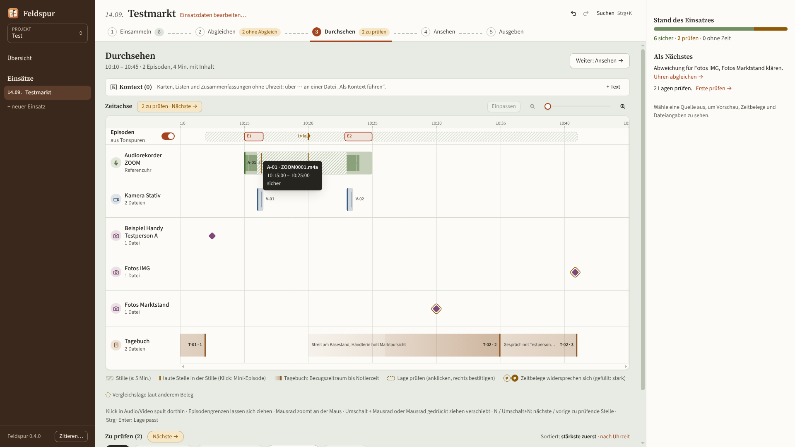
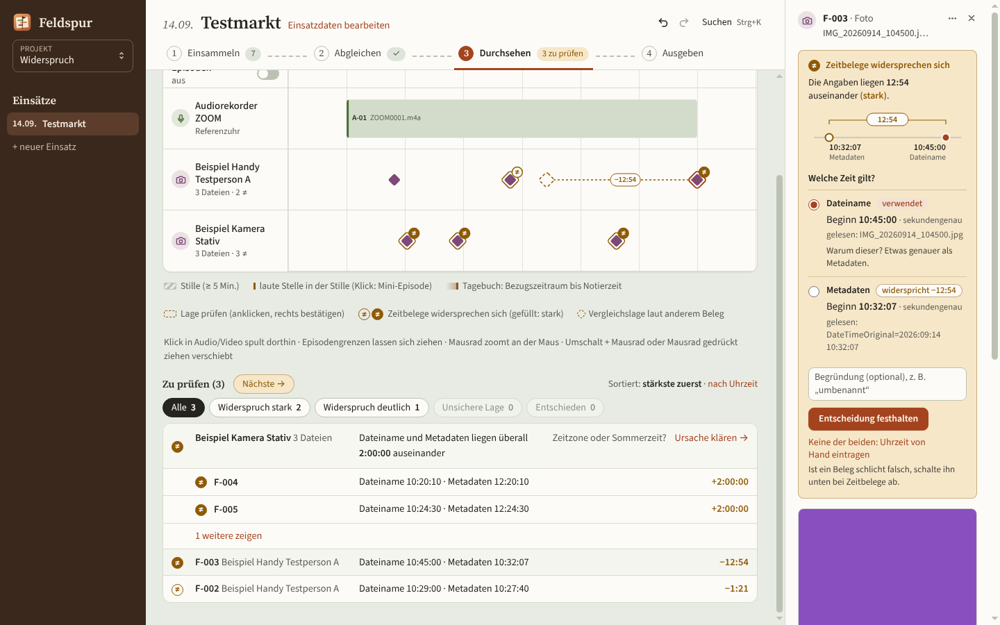

## Durchsehen {#sec-durchsehen}

Im Schritt **Durchsehen** liegt alles auf einer Zeitachse: eine Spur pro Gerät, darin die Quellen an ihrer Uhrzeit.

{#fig-durchsehen}

### Auf der Zeitachse arbeiten

- Ein **Klick** in eine Audio- oder Videospur spult dorthin; die laufenden Aufnahmen erscheinen in der Wiedergabe.
  Beim Abspielen läuft die Zeitachse mit.
- Das **Mausrad** zoomt an der Mausposition, mit [Umschalt]{.kbd} (oder waagerechtem Wischen) verschiebst du die Achse.
  Du kannst sie auch mit gedrückter **mittlerer Maustaste** (Mausrad drücken) ziehen.
  Regler und Lupen zoomen um die Abspielposition; **Einpassen** zeigt wieder den ganzen Einsatz.
- Ein Klick auf eine Quelle öffnet sie in der Detailleiste.
- Tagebuchbalken zeigen ihre Kurzform oder die erste Zeile, Clips zeigen ihre Mitschrift-Zeilen als Striche. Fährst
  du mit der Maus darüber, steht der Text dabei.

Die Legende unter der Zeitachse erklärt die Zeichen:

- **Stille (≥ 5 Min.)** ist schraffiert, eine **laute Stelle in der Stille** ist als Strich markiert, damit nichts
  Wichtiges im Leerlauf untergeht.
- **Tagebuch**: der Verlauf zeigt den Bezugszeitraum, die Kante die Notierzeit.
- **Lage prüfen** (gestrichelt): Die Lage dieser Quelle ist unsicher.
- **≠** am Balken: Die Zeitbelege dieser Quelle widersprechen sich (@sec-widersprueche).
- **Vergleichslage** (gestrichelter Umriss): Wo die Quelle stünde, wenn der abweichende Beleg gälte.

### Lagen prüfen

Ist die Lage einer Quelle unsicher, zeigt die Zeitachse oben einen Knopf wie **3 zu prüfen · Nächste →**. Er springt
der Reihe nach zu diesen Stellen; mehrere Dateien mit demselben Widerspruch zählen als eine. Passt die Lage,
bestätigst du das rechts in der Detailleiste mit **✓ Lage passt, als geprüft markieren**; dort steht dann **Von Hand
geprüft: Die Lage passt.** Feldspur wählt danach gleich die nächste Stelle, und der Balken unter **Stand des
Einsatzes** wird ein Stück grüner. Ist keine mehr übrig, steht statt des Knopfs **Alle Stellen geprüft · Weiter:
Ausgeben →** (sobald auch keine Datei mehr ohne Zeit ist). Die Bestätigung ist ein eigener Zeitbeleg und lässt sich
mit **Zurücknehmen** wieder löschen. Ist die Uhr des ganzen Geräts unbekannt, kannst du auch für alle seine Dateien
bestätigen, dass die Uhr stimmt (**Uhr von … stimmt**).

Tastenkürzel in Durchsehen (nicht, solange du in einem Textfeld schreibst oder ein Dialog offen ist):

- [N]{.kbd}: nächste zu prüfende Stelle, [Umschalt+N]{.kbd}: vorige,
- [Strg+Enter]{.kbd} (macOS: [⌘+Enter]{.kbd}): **Lage passt** für die gewählte Quelle.

### Wenn Zeitbelege sich widersprechen {#sec-widersprueche}

Oft hat eine Datei mehrere Zeitbelege, etwa die Aufnahmezeit in den Metadaten und eine Uhrzeit im Dateinamen. Feldspur
vergleicht sie. Liegen sie weiter auseinander, als ihre Genauigkeit erklärt, ist das ein **Widerspruch**:

- **deutlich** (umrandetes ≠): unter 5 Minuten Unterschied,
- **stark** (gefülltes ≠): 5 Minuten oder mehr.

Harmlose Unterschiede meldet Feldspur nicht: eine Minute Rundung, wenn der Dateiname nur die Minute kennt, oder ganze
Stunden, die es als Zeitzone oder Sommerzeit deutet. Hängen Belege an verschiedenen Uhren, die noch nicht abgeglichen
sind, steht dort nur **Uhr nicht abgeglichen** statt eines Widerspruchs.

{#fig-widerspruch}

Unter der Zeitachse sammelt die Liste **Zu prüfen** alles, was Aufmerksamkeit braucht, die starken Widersprüche
zuerst (umstellbar auf **nach Uhrzeit**). Die Filter **Widerspruch stark**, **Widerspruch deutlich** und **Unsichere
Lage** grenzen ein, **Entschieden** zeigt, was du schon entschieden hast. Haben mehrere
Dateien eines Geräts denselben Widerspruch, etwa weil die Kamera zwei Stunden falsch ging, stehen sie als eine Zeile
da.

Wählst du eine Quelle mit Widerspruch, zeigt die Detailleiste:

1. Die Belege im Vergleich: jeden Wert mit Herkunft, Genauigkeit und Abstand zum verwendeten Beleg, darüber
   ein kleines Zeitband.
2. **Wahrscheinliche Ursache**, wenn Feldspur eine erkennt, mit dem passenden Knopf, zum Beispiel **Als Ortszeit lesen**
   für alle Dateien des Geräts oder **Uhr in Abgleichen ansehen**.
3. **Welche Zeit gilt?** Feldspur schlägt den genauesten Beleg vor und sagt, warum. Wählst du einen anderen, steht
   vor dem Speichern da, wohin die Quelle rückt.
4. Eine optionale **Begründung** und **Entscheidung festhalten**. Bei einer Gruppe steht zuerst die Ursache.
   Darunter wählst du **Für alle 3 gleich entscheiden** (dann zum Beispiel **Dateiname gilt**; jede Datei behält
   ihren eigenen Wert dieser Art) oder **Nur für diese Datei entscheiden**.

Passt keiner der Belege, trägst du die Uhrzeit über **Keine der beiden: Uhrzeit von Hand eintragen** selbst ein
(@sec-abgleichen). Einen einzelnen Beleg kannst du auch
abschalten, dann zählt er nicht mehr.

Die Entscheidung wird im Projekt gespeichert, mit Datum, gewähltem Beleg, Begründung und dem Stand der Belege zu
diesem Zeitpunkt. Sie steht im Änderungsprotokoll und lässt sich mit **Zurücknehmen** aufheben. Passt sie später
nicht mehr zum Stand der Belege, etwa nach einem neuen Abgleich, meldet Feldspur **Entscheidung neu prüfen**.

### Ohne Uhrzeit

Quellen, für die Feldspur noch keine Uhrzeit kennt, liegen unter der Zeitachse im Bereich **Ohne Uhrzeit**. Wähle sie aus und gib
ihnen eine Zeit (@sec-abgleichen). Gehört eine Quelle gar nicht in den Ablauf, etwa eine Kartenzeichnung, führst du
sie stattdessen als Kontext (@sec-kontext). Sie steht dann in der Kontext-Zeile über der Zeitachse.

{#fig-wiedergabe}

### Lautstärke angleichen

Verschiedene Geräte nehmen oft sehr unterschiedlich laut auf. In der Detailleiste einer Audio- oder Videoquelle
stellst du unter **Lautstärke** ein, ob sie automatisch auf einen gleichen Sprachpegel gebracht wird (**automatisch**), um einen festen
Wert in dB verstärkt wird (**von Hand**) oder unverändert bleibt (**aus**). **Leise Stellen anheben** schaltet zusätzlich einen Kompressor
ein. Das gilt beim Abhören, beim Mitschreiben und im Montagevideo; die Originaldatei bleibt unverändert, und das
Begleitprotokoll vermerkt die Verstärkung.

### Episoden (auf Wunsch)

Mit dem Schalter **Episoden bilden** teilt Feldspur den Einsatz in **Episoden**: Zeiträume, in denen eine Aufnahme
läuft und nicht nur Stille ist. Lücken unter 5 Minuten werden verbunden. Dazwischen liegen **Zwischenzeiten**, in
denen nur Fotos und Tagebucheinträge entstanden sind. Episoden brauchen abgeglichene Tonspuren (@sec-abgleichen).
Sie helfen, lange Feldtage mit vergessenem Diktiergerät kompakt auszugeben (@sec-ausgeben). Ohne Episoden bleibt
alles in Echtzeit.

Was Feldspur vorschlägt, kannst du direkt auf der Zeitachse anpassen:

- **Grenze ziehen**: Fährst du in der Episodenzeile über den Beginn oder das Ende einer Episode, wird der Zeiger zum
  Doppelpfeil. Zieh die Grenze an die richtige Stelle; eine gestrichelte Linie zeigt die Uhrzeit auf die Sekunde.
  Vergrößern geht nur, soweit dort eine Aufnahme läuft.
- **Mini-Episode**: Kurze Striche in den Zwischenzeiten markieren laute Stellen (z. B. ein Gespräch im Vorbeigehen).
  Ein Klick darauf macht daraus eine Episode von etwa 30 Sekunden. Liegt sie näher als 5 Minuten an einer anderen,
  werden beide verbunden.
- **Wellenform**: In den Audio- und Videospuren zeigt eine Wellenform, wo gesprochen wird. Leises Rauschen blendet
  sie aus, damit Gesprächsstellen auffallen.

Hast du etwas angepasst, steht unter "Episoden" **↺ zurücksetzen**; damit verwirfst du alle Anpassungen des Einsatzes.
Feldspur speichert die Anpassung je Aufnahme ab Dateibeginn, sie wandert also mit, wenn du den Abgleich der Uhren
später änderst.

Von hier aus geht es weiter zum Abtippen des Tagebuchs (@sec-tagebuch) und zum Mitschreiben (@sec-mitschreiben).
