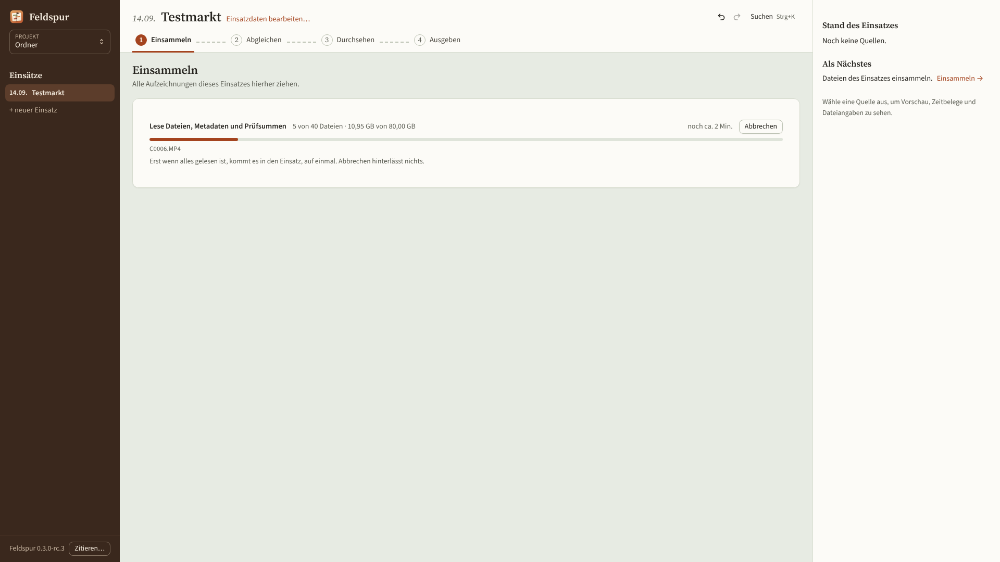
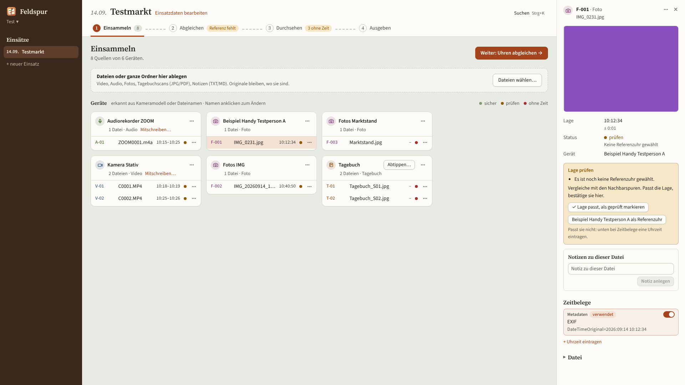

## Einsammeln {#sec-einsammeln}

Zieh alle Aufzeichnungen des Einsatzes in das Fenster: einzelne Dateien oder ganze Ordner. Einzelne Dateien
findest du auch über **Dateien wählen…**. Feldspur liest dabei für jede Datei

- die **Art** (Video, Audio, Foto, Tagebuchscan als JPG oder PDF, Notiz als TXT oder MD),
- die **Länge** bei Audio und Video,
- eine **Prüfsumme** (SHA-256), mit der sich später belegen lässt, dass das Original unverändert ist,
- alle **Zeitbelege**, die es findet: Aufnahmezeit aus den Metadaten (z. B. EXIF bei Fotos, `creation_time` bei
  Videos, BWF bei Rekorder-WAVs) und Uhrzeiten im Dateinamen (@sec-zeitquellen).

Begleitdateien, die Kameras neben die Aufnahmen legen, überspringt Feldspur. Dateien, die schon im Einsatz sind,
werden nicht doppelt übernommen. Landen Dateien anderswo im Fenster, übernimmt Feldspur nichts und bietet an,
**Einsammeln** zu öffnen.

### Woher die Uhrzeiten kommen {#sec-zeitquellen}

| Quelle | Was Feldspur liest | Genauigkeit |
|---|---|---|
| Fotos | EXIF-Aufnahmezeit, mit Sekundenbruchteilen, falls vorhanden | Sekunde, mit Bruchteilen ± 0,05 s |
| iPhone-Videos | Apple-Aufnahmedatum mit Zeitzone | Sekunde |
| Profikameras mit Aufnahme-XML (z. B. Panasonic HC-X1500) | Aufnahmebeginn aus dem XML, mit Zeitzone der Kamera | Sekunde |
| Kameras mit frei laufendem Timecode | Timecode, abgeglichen mit der Kamerauhr über alle Clips | Bruchteile einer Sekunde |
| andere Videos und Audio | `creation_time`, BWF-Felder von Rekordern | Sekunde |
| Dateinamen | z. B. `IMG_20260914_104050`, `2026-09-14 10.32.15`; Pixel-Namen wie `PXL_20260914_103215123` mit Millisekunden | Sekunde, Pixel ± 0,25 s |

**Beginn oder Ende?** MP4-Dateien sagen nicht, ob `creation_time` den Aufnahmebeginn meint oder den Moment, in dem die
Datei gespeichert wurde. Viele Android-Handys, etwa Google Pixel, schreiben das **Ende**. Feldspur erkennt das beim
Einsammeln an allen Videos eines Geräts gemeinsam: Ergibt Uhrzeit im Dateinamen plus Länge ungefähr `creation_time`,
oder würden sich die Clips eines Geräts sonst überlappen (was physisch nicht geht), gilt der Stempel als Ende. In der
Detailleiste steht dann **Metadaten (Aufnahmeende …)**. Kurze Clips unter 20 Sekunden erkennt Feldspur am Pixel-Namen
auch einzeln. Sammelst du die Dateien eines Geräts nach und nach ein, betrachtet Feldspur die schon eingesammelten
Clips desselben Geräts mit und zieht ihre Zeiten nach; das Ergebnis ist dasselbe wie beim Einsammeln auf einmal.

**UTC im Dateinamen:** Pixel-Handys benennen Dateien nach der Uhrzeit in UTC, nicht nach der Ortszeit. Feldspur rechnet
sie wie als UTC markierte Metadaten in die Zeitzone des Einsatzes um.

**Kamera-Timecode:** Viele Videokameras schreiben einen bildgenauen Timecode, ihre Uhr aber nur auf die Sekunde. Läuft
der Timecode frei mit (in der Kamera meist „Free Run“), ist sein Abstand zur Kamerauhr in allen Clips gleich. Feldspur
schätzt diesen Abstand aus allen Clips des Geräts im Einsatz, auch wenn du sie nach und nach einsammelst, und ordnet jeden Clip damit auf Bruchteile einer
Sekunde genau ein; untereinander liegen die Clips dann bildgenau. Das klappt ab zwei Clips desselben Geräts. Wurde der
Timecode zwischendurch neu gesetzt, wertet Feldspur die Abschnitte davor und danach getrennt aus. Läuft er nur während
der Aufnahme („Rec Run“), passen die Clips nicht zusammen, und Feldspur nimmt wie bisher die Kamerauhr. Drop-Frame-Timecode (29,97 mit `;`) wertet Feldspur nicht aus.

**Zeitzone der Kamera:** Das Aufnahme-XML nennt die Zeitzone, auf die die Kamera eingestellt war, und Feldspur zeigt sie
im Zeitbeleg an (z. B. „Zeitzone der Kamera +01:00“). Passt sie nicht zur Zeitzone des Einsatzes (etwa +01:00 im
Sommer in Deutschland), ist meist nur die Zone falsch eingestellt und die Uhr trotzdem nach der Ortszeit gestellt.
Feldspur nimmt dann die Uhrzeit, wie die Kamera sie anzeigte, und stellt das Gerät im Gerätemenü unter **Zeitstempel in
UTC** auf **Sind schon Ortszeit, so lesen**. Stimmte die Zone doch, stell dort auf **Sind UTC, in Ortszeit umrechnen**.

### Große Ordner

Die meiste Zeit kostet die Prüfsumme: Feldspur muss dafür jede Datei einmal ganz lesen. Bei einer vollen Speicherkarte
mit stundenlangen Videos kann das dauern, von einer externen Festplatte oder einem Netzlaufwerk deutlich länger als von
der internen SSD. Während des Einsammelns siehst du daher, wie viele Dateien und Gigabyte schon gelesen sind, welche
Datei gerade dran ist und, nach ein paar Sekunden, eine geschätzte Restzeit. Du kannst dabei in andere Schritte oder
Einsätze wechseln; das Einsammeln läuft weiter.

{#fig-einsammeln-gross}

- **Abbrechen** beendet das Lesen sofort. In den Einsatz kommt dann **nichts**: Feldspur übernimmt Dateien erst, wenn
  alle gelesen sind, und dann auf einmal. Was vorher schon im Einsatz war, bleibt unverändert.
- **Ein neuer Versuch** mit demselben Ordner übernimmt die schon gelesenen Dateien sofort, solange Feldspur offen
  bleibt und die Dateien unverändert sind. Nach einem Neustart liest Feldspur sie erneut.
- **Unlesbare Dateien** (fehlende Leserechte, defekte Verknüpfungen) überspringt Feldspur und nennt sie danach unter
  den Hinweisen; der Rest wird trotzdem eingesammelt.

Tipp: Sehr große Bestände lieber in Etappen einsammeln, etwa eine Speicherkarte nach der anderen. Doppelte Dateien
erkennt Feldspur an der Prüfsumme und übernimmt sie nicht zweimal.

{#fig-einsammeln}

### Geräte

Feldspur gruppiert die Quellen nach **Geräten**, weil jedes Gerät seine eigene Uhr hat. Es erkennt das Gerät am
Kameramodell in den Metadaten oder an der Art, wie die Dateien benannt sind. Jede Quelle bekommt ein Kurzzeichen wie
im Begleitprotokoll: `V-01` für Video, `A-01` für Audio, `F-001` für Fotos, `T-01` für Tagebuchseiten.
Hat ein Gerät viele Dateien, scrollt seine Liste innerhalb der Karte. Darunter steht, wie viele davon noch zu
**prüfen** sind oder **ohne Zeit**; ein Klick darauf springt zur ersten davon.

Über die Menüs ⋯ an jeder Quelle und an jedem Gerät kannst du nachhelfen:

- **Umbenennen**: Ein Klick auf den Namen eines Geräts macht ihn zum Textfeld, z. B. für "Kamera Stativ" oder
  "Handy Testperson A".
- **In anderes Gerät verschieben** (Menü der Quelle, auch in ein **Neues Gerät…**) oder **Zusammenlegen mit …**
  (Menü des Geräts), wenn Feldspur zwei Geräte vermutet, wo nur eins war.
- **Setzt Aufnahme fort …**: Viele Geräte teilen lange Aufnahmen in mehrere Dateien. Solche Folgeaufnahmen erkennt
  Feldspur meist selbst (gleiches Gerät, Beginn direkt am Ende der vorigen Datei, oder GoPro-Kapitel). Eine
  Folgeaufnahme ohne eigene Zeit beginnt am Ende der vorigen.
- **Als weiteres Bild zu Seite …**: eine Rückseite oder ein zweiter Scan derselben Tagebuchseite. Das Bild übernimmt
  die Zeit der Seite, ihr Gerät und ihre Art (ein Foto an einer Tagebuchseite wird selbst zur Seite, `F-…` zu `T-…`).
- **Als Tagebuchseite behandeln** / **Als Foto behandeln**: Ob ein Bild eine Tagebuchseite ist, schätzt Feldspur beim
  Einsammeln am Dateinamen ("Tagebuch", "Scan", "Seite 3" …) und daran, ob Kameradaten (EXIF) fehlen. Mit dem Handy
  abfotografierte Notizbuchseiten haben aber EXIF und landen deshalb bei den Fotos; umgekehrt kann ein Foto ohne EXIF
  mit passendem Namen als Seite gelten. Beim Umstellen bekommt das Bild ein neues Kurzzeichen, kommt in das Gerät
  „Tagebuch“ bzw. in das Fotogerät, das Feldspur beim Einsammeln gewählt hätte, und weitere Bilder der Seite gehen
  mit. Ein dadurch leeres Gerät verschwindet. Eine Tagebuchseite liegt auf der Zeitachse nur nach ihren Randnotizen und
  Einträgen, nicht nach der Aufnahmezeit des Fotos (@sec-tagebuch). Eine Seite mit Einträgen lässt sich erst wieder
  als Foto behandeln, wenn die Einträge gelöscht sind.
- **Zeitzone der Geräteuhr** (Menü am Gerät), falls ein Gerät auf eine andere Zeitzone gestellt war als der Einsatz.
- **Zeitbelege neu lesen** (Menü am Gerät) liest Metadaten, Dateinamen und Kamera-Timecode aller Quellen des Geräts
  noch einmal aus den Originaldateien, etwa wenn eine neuere Feldspur-Fassung mehr Zeitquellen kennt
  (@sec-zeitquellen). Anker, angesagte Uhrzeiten, Handeingaben und deine Entscheidungen bleiben, ebenso die
  Einstellungen des Geräts. Rückgängig machen geht wie immer mit Strg/⌘+Z.
- **Bestätigungen entfernen** (Menü am Gerät) nimmt alle „geprüft“-Bestätigungen und Entscheidungen bei Widersprüchen an den Quellen
  des Geräts auf einmal zurück. Eine Bestätigung hält eine Lage fest; ohne sie folgen die Quellen wieder dem
  genauesten Zeitbeleg, zum Beispiel einem neu gelesenen Timecode.
- **Aus Projekt entfernen** nimmt die Quelle aus dem Projekt; die Originaldatei bleibt, wo sie ist.

Wenn alles eingesammelt ist, geht es mit **Weiter: Uhren abgleichen →** zum Abgleichen.

### Originaldateien {#sec-originale}

Feldspur kopiert nichts: Es merkt sich, wo jedes Original liegt, und liest es dort. Verschiebst du den Ordner mit den
Aufnahmen, steckst ein Laufwerk um oder öffnest das Projekt auf einem anderen Rechner, findet Feldspur die Dateien
unter dem alten Pfad nicht mehr. Dann steht unter den Schritten **„2 Originaldateien fehlen“** und in der Detailleiste
der Quelle ein Hinweis. Vorschau, Tonanalyse und Ausgabe brauchen die Originale; die Tonanalyse überspringt fehlende
Aufnahmen und nennt sie.

Mit **Originale suchen…** öffnet sich eine Liste aller Quellen mit ihrem Zustand:

| Zustand | Bedeutung |
|---|---|
| unverändert | Datei da, Größe und Prüfsumme wie beim Einsammeln |
| da, Prüfsumme nicht geprüft | Datei da und gleich groß; die Prüfsumme wurde in dieser Sitzung noch nicht gerechnet |
| verändert | Größe oder Prüfsumme anders als beim Einsammeln, z. B. nachbearbeitet oder überschrieben |
| fehlt | unter dem gespeicherten Pfad liegt keine Datei |
| nicht prüfbar | da, aber nicht lesbar (Zugriffsrechte, Laufwerksfehler) |

- **Ordner durchsuchen…** sucht alle fehlenden und veränderten Originale in einem Ordner und seinen Unterordnern
  (versteckte Ordner ausgenommen, höchstens 50 000 Dateien). Kandidaten sind Dateien gleicher Größe, gleichnamige
  zuerst; so findet sich auch eine umbenannte Datei.
- **Datei wählen…** verknüpft eine einzelne Quelle mit einer Datei, die du selbst auswählst.
- **Alle Prüfsummen prüfen** liest alle Originale einmal und vergleicht sie mit der Prüfsumme vom Einsammeln. Bei
  langen Videos dauert das einige Minuten; bis zum Beenden merkt sich Feldspur das Ergebnis.

Feldspur übernimmt einen neuen Pfad **nur, wenn die Prüfsumme (SHA-256) stimmt**. Eine Datei mit gleichem Namen, aber
anderem Inhalt wird nie übernommen; die Suche nennt sie mit Grund. Jede Neuverknüpfung ist ein eigener Schritt, den du
rückgängig machen kannst, und steht mit altem und neuem Pfad im Änderungsprotokoll. Der Dateiname im Quellennachweis
bleibt der vom Einsammeln. Sammelst du die verschobenen Dateien einfach erneut ein, verknüpft Feldspur sie ebenso neu,
statt sie doppelt aufzunehmen.

Prüfergebnisse sind keine Forschungsdaten: Sie stehen nicht in der Projektdatei und nicht in der Ausgabe.

### Formate {#sec-formate}

Feldspur nimmt jede Datei auf und liest ihre Zeit, so gut es geht. Ansehen, abhören und mitschreiben kannst du aber
nur Formate, die das Programmfenster selbst darstellen kann. Feldspur legt dafür keine eigenen Kopien an. Wandle
andere Formate vorher selbst um, und sammle die umgewandelte Datei zusätzlich ein oder statt des Originals. Ins
Montagevideo kommen auch die Videos und Tonaufnahmen aus der rechten Spalte, weil FFmpeg sie liest. Kann Feldspur eine
Datei nicht zeigen, steht in der Detailleiste ein Hinweis.

| Art | Geht direkt | Selbst umwandeln |
|---|---|---|
| Video | MP4, MOV, M4V, MKV und WebM mit H.264, VP9 oder AV1 | MTS/M2TS, AVI; HEVC (H.265) je nach Rechner |
| Audio | WAV, MP3, M4A/AAC, FLAC, OGG, Opus | WMA, AMR |
| Fotos und Scans | JPEG, PNG, WebP, GIF, PDF | HEIC/HEIF, TIFF, DNG und andere RAW-Formate |

Zum Umwandeln eignen sich z. B. HandBrake oder FFmpeg für Video und Audio (Ziel: MP4 mit H.264 und AAC, oder WAV)
sowie die Fotos-App, Vorschau (macOS) oder darktable für Bilder (Ziel: JPEG). Achte darauf, dass das Werkzeug die
Aufnahmezeit mitnimmt; sonst trägst du sie in Feldspur von Hand ein (@sec-abgleichen). Das Original bleibt die
Quelle, auf die sich das Begleitprotokoll bezieht, wenn du es mit einsammelst.

::: {.callout-note}
HEVC-Videos von neueren Handys spielt Feldspur unter macOS und Windows meist ab, weil es dort den Decoder des
Systems nutzt. Unter Linux fehlt er in der Regel. Bleibt das Bild schwarz, wandle das Video in H.264 um.
:::
