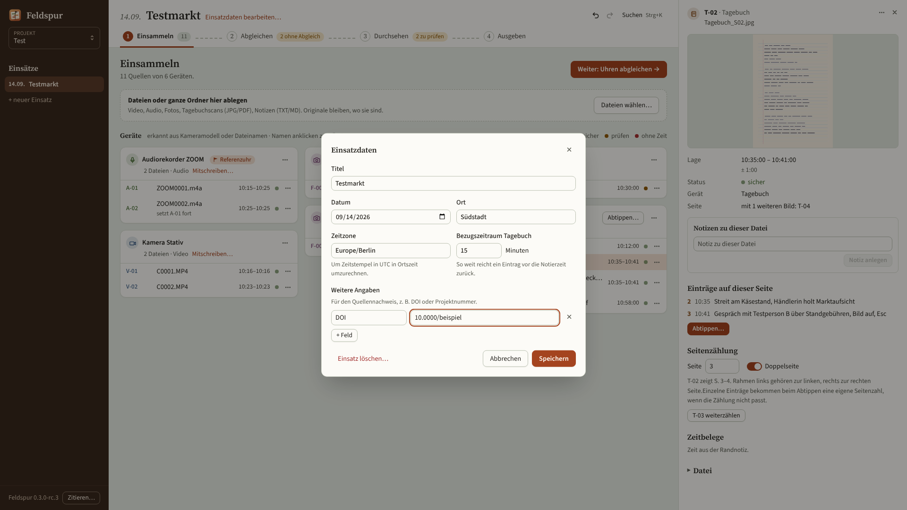
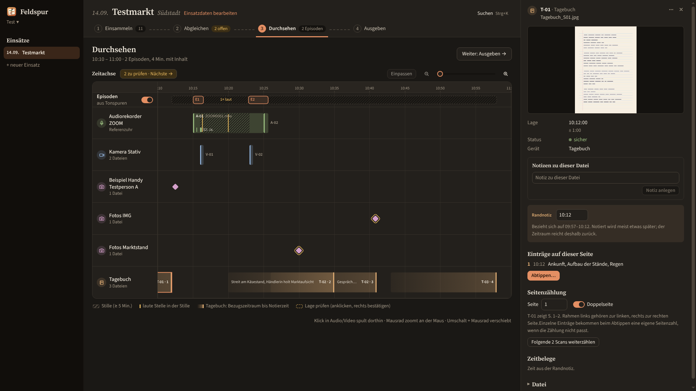

## Erste Schritte {#sec-erste-schritte}

### Installieren



FFmpeg [@ffmpeg] (in der LGPL-Fassung) ist bereits enthalten, du musst nichts weiter installieren.

::: {.callout-note}
Die Pakete sind noch nicht signiert. Ohne Lieferling warnen Windows und macOS deshalb beim ersten Start. Unter macOS
öffnest du die App beim ersten Mal per Rechtsklick › Öffnen, unter Windows über "Weitere Informationen" › "Trotzdem ausführen".
:::

### Projekt und Einsatz

Feldspur speichert alles in einer **Projektdatei** (Endung `.feldspur`). Beim Start wählst du **Neues Projekt…** oder
**Projekt öffnen…**; zuletzt geöffnete Projekte stehen in einer Liste darunter. Später wechselst du das Projekt links
oben über das Feld **Projekt** (oder [Strg+O]{.kbd}, auf dem Mac [⌘+O]{.kbd}); dort stehen die zuletzt geöffneten
Projekte, **Anderes Projekt öffnen…** und **Neues Projekt…**. Auch ein Doppelklick auf eine Projektdatei öffnet
Feldspur (unter Linux nur, wenn das AppImage ins System eingebunden ist, etwa mit AppImageLauncher).

Ein Projekt enthält einen oder mehrere **Einsätze**. Ein Einsatz ist ein Feldtag an einem Ort und wird später zu
genau einem Dokument in MAXQDA. Ein neues Projekt zeigt dafür gleich ein Formular: Gib Titel, Datum und Ort ein und wähle **Einsatz anlegen**. Weitere
Einsätze legst du in der linken Leiste mit **+ neuer Einsatz** an; der Ort ist dort optional und lässt sich später in
den Einsatz-Details ändern.

Über den Einsätzen steht in der Leiste die **Übersicht** mit allen Einsätzen des Projekts im **Feldkalender** und
den **Kennwerten** für den Methodenteil (@sec-methodenteil).

Das Datum ist mit dem heutigen Tag vorbelegt. Stammen die meisten Dateien beim Einsammeln von einem anderen Tag,
steht über der Geräteliste ein Hinweis mit dem Knopf **Datum auf … setzen**; von Hand eingetragene Uhrzeiten wandern
mit. Liegen die Dateien auf mehreren Tagen, weist Feldspur darauf hin, dass ein Einsatz ein Feldtag ist.

Einen Testeinsatz oder einen doppelt angelegten Einsatz löschst du unter **Einsatzdaten bearbeiten…** mit **Einsatz
löschen…**. Damit verschwindet alles, was in Feldspur dazu entstanden ist: Quellen, Zeitbelege, Anker,
Tagebucheinträge, Mitschrift und Notizen. Originaldateien und frühere Ausgaben bleiben erhalten. **Rückgängig** holt
den Einsatz zurück, solange das Projekt offen ist und du seitdem nichts eingesammelt oder analysiert hast; danach
hilft nur eine Sicherung (@sec-sicherungen).

::: {.callout-tip}
### Deine Originale bleiben, wo sie sind
Feldspur kopiert und verändert keine Originaldateien. Die Projektdatei merkt sich nur, wo sie liegen, und hält ihre
Prüfsumme fest. Verschiebe den Ordner mit den Aufnahmen deshalb nach dem Einsammeln möglichst nicht mehr.
:::

### Einsatzdaten

Über **Einsatzdaten bearbeiten…** neben dem Titel trägst du ein, was zum Quellennachweis gehört:

- **Ort**, z. B. "Marktplatz".
- **Zeitzone** des Einsatzes. Manche Geräte schreiben ihre Zeitstempel in UTC; Feldspur rechnet sie damit in die
  Ortszeit um. Alle Uhrzeiten in Feldspur sind Ortszeit des Einsatzes.
- **Bezugszeitraum Tagebuch**: wie weit ein Tagebucheintrag vor die Notierzeit zurückreicht (Standard
  15 Minuten), siehe @sec-tagebuch.
- **Weitere Angaben**, frei wählbare Felder für den Quellennachweis, z. B. DOI oder Projektnummer. Mit **+ Feld**
  kommt eins dazu.

{#fig-einsatzdaten}

### Die vier Schritte

Oben im Fenster stehen die vier Arbeitsschritte eines Einsatzes. Kleine Hinweise an den Reitern zeigen, wo noch etwas
offen ist. Die Wörter sind überall dieselben: "zu prüfen" heißt, Feldspur hat einen Vorschlag oder eine unsichere
Lage, die du bestätigen solltest; "ohne Abgleich" und "ohne Zeit" heißen, dass noch etwas fehlt.

1. **Einsammeln** (@sec-einsammeln): alle Dateien hineinziehen, Feldspur ordnet sie Geräten zu.
2. **Abgleichen** (@sec-abgleichen): die Uhren der Geräte aufeinander abstimmen.
3. **Durchsehen** (@sec-durchsehen): alles auf der Zeitachse prüfen, Tagebuch abtippen, mitschreiben.
4. **Ausgeben** (@sec-ausgeben): Einsatztranskript für MAXQDA, Dokumentvariablen und Begleitprotokoll schreiben, dazu auf Wunsch Montagevideo, Viewer und LIESMICH.

Rechts öffnet sich zu jeder gewählten Quelle die **Detailleiste** mit Vorschau, Lage auf der Zeitachse,
Zeitbelegen und Dateiangaben. Mit **Suchen** ([Strg+K]{.kbd}, auf dem Mac [⌘+K]{.kbd}) durchsuchst du Mitschrift, Notizen, Tagebuch,
Quellen und Episoden, auch nach einer Uhrzeit. Ein Treffer in der Mitschrift öffnet das Mitschreiben an dieser
Stelle. Die Liste zeigt höchstens 60 Treffer in Uhrzeit-Reihenfolge; grenze die Suche sonst ein, etwa mit einer
Uhrzeit wie 10:15 oder einem weiteren Wort.

**Rückgängig** ([Strg+Z]{.kbd}, auf dem Mac [⌘+Z]{.kbd}) nimmt den letzten Schritt zurück, etwa eine entfernte Quelle, einen
gelöschten Anker, einen übernommenen Vorschlag oder "Lage passt". **Wiederholen** geht mit [Strg+Y]{.kbd} oder
[Strg+Umschalt+Z]{.kbd} ([⇧+⌘+Z]{.kbd}). Beide Knöpfe stehen auch oben neben **Suchen**. Das gilt für fast alles in
Feldspur; die folgenden Kapitel erwähnen es nur, wo es Besonderheiten gibt. Feldspur fragt deshalb vor dem Löschen
meist nicht nach; stattdessen erscheint unten kurz ein Hinweis mit **Rückgängig**. Nur bei Notizen und
Mitschrift-Zeilen mit Text wird der Löschknopf erst zu **Wirklich löschen?**, und der zweite Klick löscht. In
Textfeldern macht [Strg+Z]{.kbd} zuerst den Text im Feld rückgängig. Der Verlauf gilt, solange das Projekt offen ist.
Nach dem Einsammeln oder der Tonspur-Analyse beginnt er neu.

**Uhrzeiten** tippst du überall ohne Doppelpunkt: "1030" wird 10:30, "103045" wird 10:30:45. Mit [↑]{.kbd} und
[↓]{.kbd} verschiebst du um eine Minute, mit [Umschalt]{.kbd} um zehn.

Alle Tastenkürzel stehen auch auf einem
[Spickblatt zum Ausdrucken](https://purl.archive.org/feldspur/tastenkuerzel) (eine Seite A4 quer), angeordnet wie auf
der Tastatur.

Davon unabhängig führt Feldspur ein dauerhaftes **Änderungsprotokoll** in der Projektdatei. Jede gespeicherte
Änderung steht dort mit Zeit, Aktion und den Werten vorher und nachher. Du öffnest es im Projektmenü oben links über
**Änderungsprotokoll…**. **Als CSV speichern…** legt das ganze Protokoll als Tabelle ab, etwa für die Dokumentation
des Forschungsprozesses. Das Protokoll ist nur zum Nachsehen da; zurücknehmen geht weiter über Rückgängig.

### Sicherungen {#sec-sicherungen}

Die Projektdatei hält deine Entscheidungen, Zeitbelege und das Änderungsprotokoll. Feldspur sichert sie deshalb
selbst: **beim Öffnen**, **während der Arbeit** höchstens alle 30 Minuten und **beim Schließen**, jeweils nur, wenn
sich etwas geändert hat, und bevor eine neue Feldspur-Version eine ältere Projektdatei aktualisiert.

Die Sicherungen liegen in einem Ordner neben der Projektdatei, z. B. `Feldforschung-Sicherungen`. Jede ist eine
vollständige Projektdatei mit Datum, Uhrzeit und Anlass im Namen. Von den automatischen bleiben die letzten zehn
liegen, von denen vor einer Aktualisierung die letzten fünf. Eigene Sicherungen löscht Feldspur nie.

Im Projektmenü oben links öffnet **Sicherungen…** die Liste, die neueste oben. **Sicherung erstellen…** legt eine
eigene an, etwa vor einem größeren Umbau. **Als Kopie öffnen…** macht aus einer Sicherung ein eigenständiges Projekt
unter neuem Dateinamen; die ursprüngliche Projektdatei und die Sicherung bleiben, wie sie sind. **Andere Datei als
Kopie öffnen…** tut dasselbe mit einer Sicherung, die woanders liegt, und **Ordner zeigen** öffnet den
Sicherungsordner.

Lässt sich eine Projektdatei nicht öffnen, weil sie unvollständig oder beschädigt ist, sagt eine Meldung, was nicht
stimmt, und auf dem Startbildschirm steht **Sicherung als Kopie öffnen…** bereit.

::: {.callout-tip}
### Sicherungsstrategie
Der Sicherungsordner liegt auf demselben Laufwerk wie das Projekt. Gegen einen Laptopverlust oder ein defektes
Laufwerk hilft er nicht. Sichere den Projektordner deshalb zusätzlich wie deine Aufnahmen, etwa mit der Datensicherung
deiner Hochschule oder auf einer zweiten Festplatte. Kopiere eine Projektdatei nur, wenn Feldspur sie nicht offen hat,
oder nimm dafür **Sicherung erstellen…**. Fürs Archiv gehören Projektdatei und Originaldateien zusammen; die
automatischen Sicherungen brauchst du dort nicht.
:::

Feldspur hat ein helles und ein dunkles Erscheinungsbild und folgt der Einstellung deines Systems.

{#fig-dunkel}
