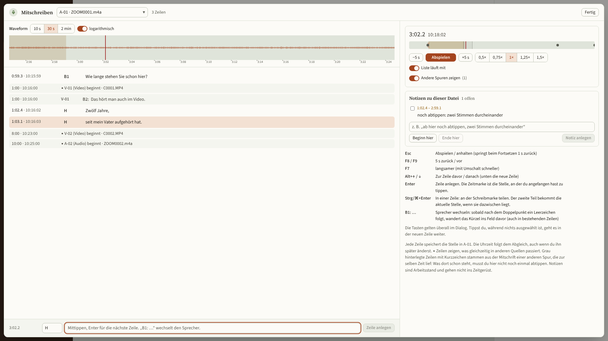

## Mitschreiben {#sec-mitschreiben}

Feldspur transkribiert **nicht automatisch**. Stattdessen tippst du mit, während die Aufnahme läuft, und Feldspur
setzt die Zeitmarken für dich.

{#fig-mitschreiben}

### So geht's

Öffne in der Detailleiste einer Audio- oder Videoquelle das Mitschreiben und wähle die **Tonquelle**. Dann:

- Tippe los. **Enter** legt die Zeile an und beginnt die nächste. Die Zeitmarke ist die Stelle, an der du angefangen
  hast zu tippen.
  Eine angefangene Zeile wird beim Schließen angelegt.
- Beginnt eine Zeile mit einem Kürzel wie `B1:` und einem Leerzeichen, wechselt der **Sprecher** sofort: Das Kürzel
  wandert ins Sprecherfeld. In einer bestehenden Zeile geht das genauso.
- Eine Zeitmarke lässt sich nachträglich auf die aktuelle Stelle setzen; **Hierhin springen** spielt eine Zeile ab.
- Über der Liste läuft eine **Waveform** mit (Ausschnitt 10 s, 30 s oder 2 min, logarithmisch oder linear). Sie zeigt,
  wo gesprochen wird, dazu die Zeilen und Notizen; ein Klick spult dorthin.
- **Liste läuft mit** hält beim Abspielen die aktuelle Zeile im Blick, auch bei langen Mitschriften.

Tastenkürzel:

| Taste         | Wirkung                                                                        |
| ------------- | ------------------------------------------------------------------------------ |
| Esc           | Abspielen / anhalten (beim Fortsetzen springt die Wiedergabe 1 s zurück)       |
| F8 / F9       | 5 Sekunden zurück / vor                                                        |
| F7            | langsamer (mit Umschalt schneller)                                             |
| Alt+↑ / ↓     | zur Zeile davor / danach (unten die neue Zeile)                                |
| Enter         | Zeile anlegen, nächste beginnen                                                |
| Strg/⌘+Enter  | Zeile an der Schreibmarke teilen                                               |
| `B1: …`       | Sprecher wechseln, wenn die Zeile so beginnt                                   |

Die Tasten gelten überall im Dialog, auch wenn du vorher auf das Video, die Waveform oder eine freie Fläche geklickt
hast. Tippst du, während kein Textfeld ausgewählt ist, geht es in der neuen Zeile weiter. Zum Danebenlegen gibt es sie
auch auf dem [Spickblatt](https://purl.archive.org/feldspur/tastenkuerzel) (A4 quer).

### Andere Spuren zur selben Zeit

Liefen zur selben Zeit andere Aufnahmen, zeigt die Liste deren Beginn als ▪-Zeile. Ist eine dieser Aufnahmen schon
mitgeschrieben, erscheinen ihre Zeilen grau hinterlegt mit dem Kurzzeichen der Quelle, etwa `V-01`. Sie lassen sich hier
nur lesen. So siehst du, was schon abgetippt ist, wenn ein Satz in Ton und Video zu hören ist. Ein Klick auf das
Kurzzeichen öffnet die andere Aufnahme an dieser Stelle. **Andere Spuren zeigen** blendet die Zeilen aus.

### Notizen zu einer Datei

Zu jeder Datei kannst du **Notizen** anlegen, mit oder ohne Zeitspanne, etwa "ab 12:30 noch abtippen, Gespräch am
Gehege". Sie stehen in der Detailleiste und beim Mitschreiben und lassen sich abhaken. Notizen sind dein
Arbeitsstand und gehen nicht ins Zeitgerüst.

Feldspur speichert zu jeder Zeile die Stelle in der Aufnahme. Die Uhrzeit folgt aus dem Abgleich; wenn du später eine
Uhr korrigierst, wandert die Mitschrift mit.

### Transkript importieren

Hast du eine Aufnahme schon anderswo transkribiert, etwa mit Whisper oder in MAXQDA, kannst du das Transkript über
**Transkript importieren…** in der Detailleiste einlesen. Feldspur versteht SRT, WebVTT, JSON (Whisper) und TSV.
Wähle, ob es **zur Mitschrift hinzugefügt** wird oder sie **ersetzt**. Der Import lässt sich mit **Rückgängig**
zurücknehmen, auch das Ersetzen. Zeilen hinter dem Ende der Aufnahme übernimmt Feldspur nicht; wie viele es waren,
steht in der Meldung nach dem Import.
