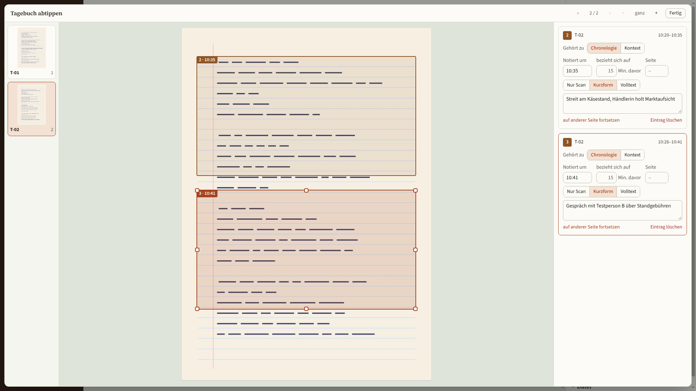
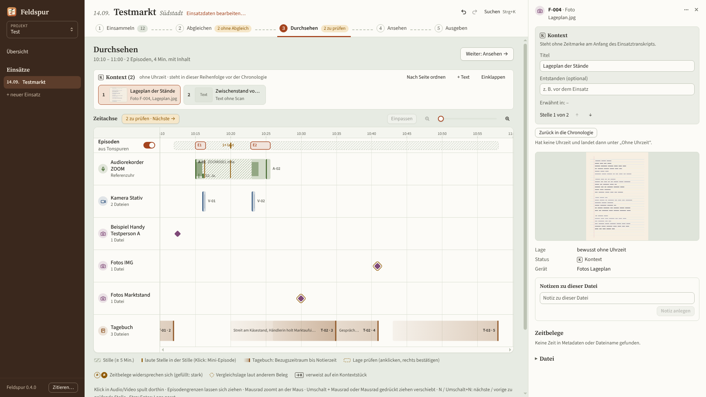
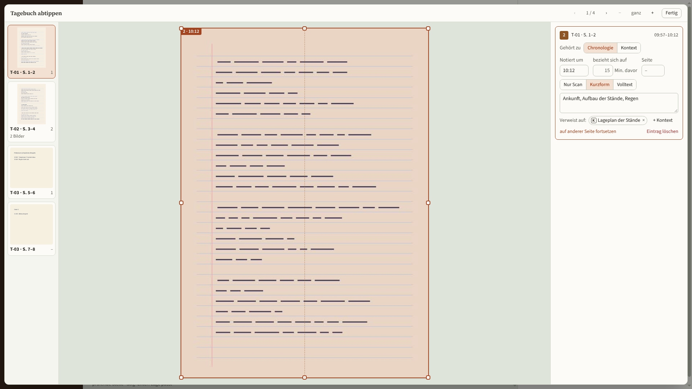

## Tagebuch abtippen {#sec-tagebuch}

Feldnotizen entstehen selten genau dann, wenn etwas passiert. Ein Eintrag, der um 14:23 notiert wurde, betrifft oft
schon, was um 14:16 geschah. Feldspur trennt deshalb die **Seite** (der Scan) vom **Eintrag** (ein Rahmen auf der
Seite mit eigener Zeit).

Hat Feldspur eine abfotografierte Seite beim Einsammeln für ein Foto gehalten, stellst du das im Menü der Quelle mit
**Als Tagebuchseite behandeln** um (@sec-einsammeln).

{#fig-tagebuch}

### Randnotiz der Seite

Steht am Rand einer Seite eine Uhrzeit, trägst du sie in der Detailleiste als **Randnotiz** ein (nur Ziffern, "1012" wird 10:12). Daraus ergibt sich,
auf welchen Zeitraum sich die Seite bezieht, auch ohne einzelne Einträge. Hat die Seite mehrere Einträge, zählen
deren Zeiten, und das Feld entfällt.

### Einträge

Öffne die Seite mit **Abtippen…** (an der Quelle oder in der Detailleiste) und zieh einen Rahmen um einen Eintrag. Dann trägst du ein:

- **Notiert um**: die Uhrzeit, zu der du den Eintrag geschrieben hast. Es reichen die Ziffern, der Doppelpunkt kommt
  von selbst ("1030" wird 10:30, "930" wird 09:30). Mit [↑]{.kbd} und [↓]{.kbd} verschiebst du die Zeit um eine Minute, mit [Umschalt]{.kbd}
  um zehn. Eine unmögliche Zeit wie 25:00 färbt das Feld rot und wird nicht gespeichert.
- **bezieht sich auf … Min. davor**: wie weit der Eintrag zurückreicht. Der Standard steht in den Einsatzdaten.
- wie du ihn erfasst:
  - **Nur Scan**: nicht abtippen, der Scan steht für sich,
  - **Kurzform**: Stichworte, worum es geht,
  - **Volltext**: wortgetreu abgetippt.

  Ein neuer Eintrag beginnt in der Form, in der du den letzten Eintrag des Einsatzes abgetippt hast (Kurzform oder
  Volltext); der erste beginnt mit Kurzform.

Ein Eintrag kann auf einer anderen Seite weitergehen; dann wählst du am Eintrag **auf anderer Seite fortsetzen** und
ziehst dort einen weiteren Rahmen für denselben Eintrag.
Eine Seite kann umgekehrt mehrere Einträge mit verschiedenen Zeiten enthalten.

Sitzt ein Rahmen nicht ganz, korrigierst du ihn, statt einen neuen Eintrag anzulegen: Klick in den Rahmen (oder auf
seine Nummer), dann bekommt er Griffe an Kanten und Ecken. Am Nummernschild oben links ziehst du ihn an eine andere
Stelle, an den Griffen änderst du die Größe. Innerhalb eines Rahmens kannst du weiterhin einen neuen aufziehen, auch
überlappend. Mit der Tastatur geht es auch: Ist der Rahmen gewählt, verschieben ihn die Pfeiltasten,
mit [Alt]{.kbd} ändern sie die Größe, mit [Umschalt]{.kbd} in großen Schritten. Notierzeit und Text bleiben am Eintrag; nur die
Nummer kann sich ändern, weil Einträge von oben nach unten gezählt werden.

### Kontext: Stücke ohne Uhrzeit {#sec-kontext}

Nicht alles im Notizbuch gehört an eine Stelle im Ablauf. Eine Kartenzeichnung des Marktes, eine Liste der Stände
oder eine Zusammenfassung vom Abend gelten für den ganzen Tag. Solche Stücke führst du als **Kontext**: Sie haben
bewusst keine Uhrzeit und stehen im Einsatztranskript vor der ersten Zeitmarke, in einem eigenen Abschnitt
"Kontext". Danach folgt wie bisher die **Chronologie**. Kontext ist kein offener Punkt und zählt nicht als "ohne
Uhrzeit".

Auf drei Wegen wird etwas zu Kontext:

- **Ganze Datei**: im Menü ⋯ einer Quelle **Als Kontext führen**, bei Tagebuchseiten **Seite als Kontext führen**.
  Bei einer Quelle ohne Uhrzeit steht derselbe Knopf auch in der Detailleiste ("Gehört nicht in die Chronologie?").
  Hat das Foto eine Uhrzeit, verlässt es die Zeitachse; die Uhrzeit bleibt gemerkt.
- **Teil einer Seite**: Zieh in der Abtipp-Ansicht einen Rahmen um die Karte und stell am Eintrag **Gehört zu** auf
  **Kontext**. Im leeren Feld "Notiert um" geht das auch mit der Taste [K]{.kbd}. Statt der Zeitfelder trägst du dann
  einen **Titel** ein (etwa "Karte 2: Standplan") und, wenn du magst, wann das Stück **entstanden** ist. Der Rahmen
  ist gestrichelt und trägt ein K.
- **Text ohne Scan**: **+ Text** in der Kontext-Zeile über der Zeitachse legt ein Stück an, das du direkt tippst, zum
  Beispiel eine abends getippte Zusammenfassung. Eine Notizdatei (.txt, .md) geht als ganze Datei; ihr Inhalt steht
  dann im Dokument.

Ton und Video können kein Kontext sein, weil sie ins Montagevideo gehen.

{#fig-kontext}

Die **Kontext-Zeile** über der Zeitachse zeigt alle Stücke in der Reihenfolge des Dokuments. Wähle ein Stück und
verschieb es mit [Alt+←/→]{.kbd} oder mit [↑]{.kbd} und [↓]{.kbd} in der Detailleiste; **Nach Seite ordnen** stellt einmal die
Reihenfolge des Notizbuchs her (Tagebuch nach Seite, dann Fotos). Ohne Titel steht im Dokument die Fundstelle, etwa
"Tagebuch T-01 · S. 3". **Zurück in die Chronologie** holt ein Stück wieder auf die Zeitachse; darunter steht, wo es
dann liegt. Jeder Schritt lässt sich rückgängig machen.

Bezieht sich ein datierter Eintrag auf ein Kontextstück ("siehe Karte 2"), setzt du am Eintrag unter **Verweist
auf** mit **+ Kontext** einen Verweis. Im Dokument steht er hinter dem Eintrag ("→ Kontext: Karte 2: Standplan"), auf
der Zeitachse trägt der Eintrag →K, und das Kontextstück zeigt unter **Erwähnt in**, woher es erwähnt wird.

{#fig-kontext-verweis}

### Blättern und Zoomen

Mit [Bild ↑]{.kbd} und [Bild ↓]{.kbd} blätterst du zur vorigen oder nächsten Seite, auch während du in einem Textfeld tippst;
dein Text wird dabei gespeichert, ebenso beim Schließen mit **Fertig** oder [Esc]{.kbd}.
Die Pfeile oben rechts tun dasselbe. Jede Seite steht zuerst ganz im Bild; kleine Scans werden dafür vergrößert. Zum
Entziffern zoomst du mit **+** und **−** oben rechts, mit [Strg/⌘]{.kbd} + Mausrad an der Stelle unter der Maus oder,
wenn kein Textfeld den Fokus hat, mit den Tasten [+]{.kbd} und [−]{.kbd}. Ein Klick auf die Prozentzahl (oder die Taste [0]{.kbd}) zeigt
wieder die ganze Seite.

### Seitenzahlen und Doppelseiten

Oft passt die Reihenfolge der Scans nicht zur Seitenzählung im Notizbuch, zum Beispiel wenn du Doppelseiten
zusammen fotografiert hast. Unter **Seitenzählung** in der Detailleiste eines Scans trägst du deshalb die
Seitenzahl ein und schaltest **Doppelseite** ein, wenn ein Bild zwei Seiten zeigt. Ein Rahmen links gehört dann zur
linken Seite, ein Rahmen rechts zur rechten. In der Abtipp-Ansicht deutet eine gestrichelte Linie den Falz an. Einträge
heißen danach etwa "T-01 · S. 7". Der Knopf darunter (etwa **T-02 weiterzählen** oder **Folgende 3 Scans weiterzählen**) setzt die Zählung über die folgenden Scans desselben Geräts fort;
PDF-Scans zählen dabei Seite für Seite weiter.

Passt die Zählung für einen Eintrag nicht, trägst du die Seite direkt am Eintrag unter **Seite** ein. Das geht auch
in PDF-Scans. Klickst du in ein leeres Feld, steht schon ein Vorschlag darin: dieselbe Seite wie beim vorigen Eintrag
oder die nächste. [Enter]{.kbd} übernimmt ihn. Ein leeres Feld gilt wieder als Zählung des Scans.

Einsatztranskript, Montagevideo, Mitschrift und Suche führen jeden Eintrag an seiner **Notierzeit**. Der Bezugszeitraum steht
als Hinweis dabei.
