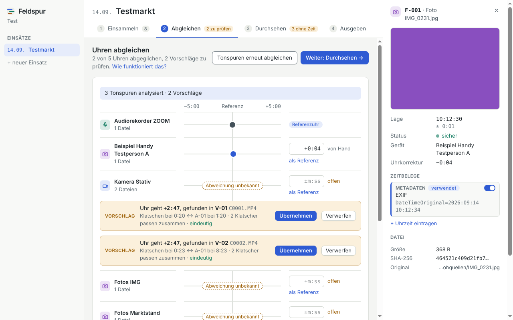
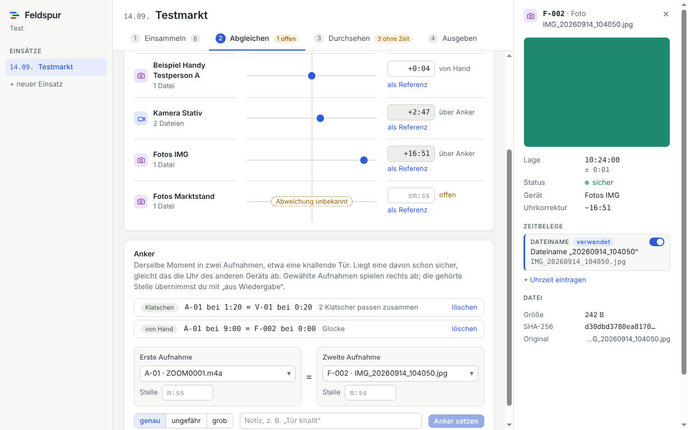
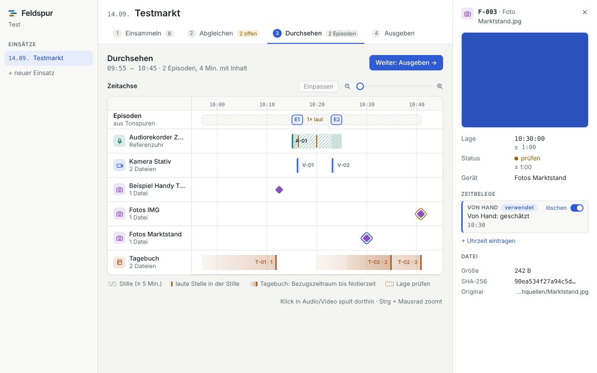

# Abgleichen {#sec-abgleichen}

Kaum eine Geräteuhr geht genau. Im Schritt **Abgleichen** stimmst du die Uhren aufeinander ab, damit alle Quellen an
der richtigen Stelle der gemeinsamen Zeitachse landen.

{#fig-abgleich}

## Referenzuhr wählen

Wähle zuerst die **Referenzuhr**: das Gerät, dessen Uhr am verlässlichsten lief, etwa ein Handy mit Netzzeit. Alle
anderen Uhren werden als Abweichung zu ihr angegeben. Ein anderes Gerät machst du mit **als Referenz** zur
Referenzuhr.

## Abweichung eintragen

Weißt du, wie weit ein Gerät abweicht, trägst du es direkt ein: „Kamera geht 2:47 vor“ wird zu `+2:47`. Auch große
Abweichungen gehen, etwa `+1 Tag 2:00:00`, wenn die Uhr auf ein falsches Datum gestellt war.

## Tonspuren abgleichen

Mit **Tonspuren abgleichen** hört Feldspur alle Audio- und Videodateien durch und sucht

- **gleiche Geräusche** in Aufnahmen, die zur selben Zeit liefen, und
- **Klatscher**, also kurze, laute Sync-Signale. Alle Klatscher eines Geräts stimmen gemeinsam über dessen Abweichung
  ab.

Daraus entstehen **Vorschläge** („Uhr geht +2:47, gefunden in V-01“). Ein Vorschlag zählt erst, wenn du ihn
**übernimmst**. Steht dabei „unsicher, bitte anhören“, prüfe die Stelle vorher. Was nicht passt, **verwirfst** du.

Dabei erkennt Feldspur auch längere **Stille** (ab 5 Minuten) und laute Stellen darin. Das braucht es später für die
Episoden (@sec-durchsehen).

## Anker von Hand

Wo nichts davon hilft, setzt du einen **Anker**: „dieser Moment in Aufnahme A ist derselbe wie dieser Moment in
Aufnahme B“, etwa eine knallende Tür. Wähle unter **Anker setzen** beide Aufnahmen und die Stelle darin, gib eine
Genauigkeit und optional eine Notiz an. Aus dem Anker ergibt sich die Abweichung des Geräts, oder eine Quelle ohne
eigene Uhrzeit erbt ihre Lage.

{#fig-anker}

## Uhrzeit von Hand

Hat eine Quelle gar keine Zeit, oder ist eine Uhrzeit in der Aufnahme angesagt („Es ist jetzt 10 Uhr 15“), trägst du
sie in der Detailleiste mit **+ Uhrzeit eintragen** ein:

- **Angesagt**: eine Uhrzeit, die an einer Stelle der Aufnahme zu hören ist. Hat die Aufnahme auch eine Zeit der
  Geräteuhr, gleicht das die Uhr des ganzen Geräts ab; die übrigen Clips rücken mit.
- **Von Hand**: gilt nur für diese Quelle und hat Vorrang vor gelesenen Zeiten.

{#fig-von-hand}

## Nachvollziehbarkeit

Feldspur speichert die Lage einer Quelle nie direkt, sondern berechnet sie jedes Mal aus den **Zeitbelegen**:
Metadaten, Dateiname, angesagte Uhrzeit, Anker oder Eingabe von Hand. In der Detailleiste siehst du, welcher Beleg
verwendet wird, und kannst einzelne Belege abschalten. Jede Lage hat eine Genauigkeit; „sicher“ heißt ± 2 Sekunden
oder besser bei bekannter Geräteuhr.
