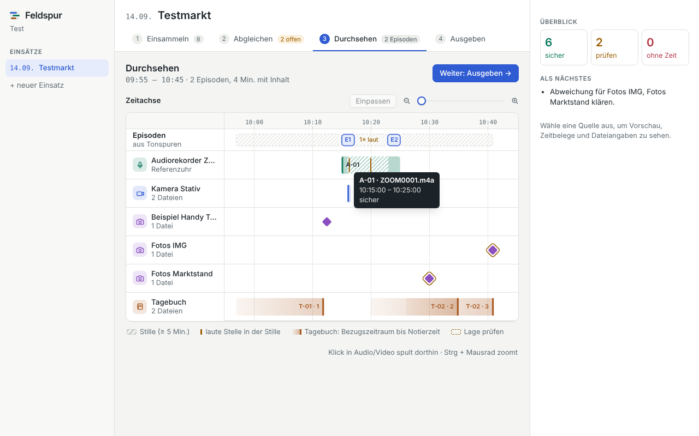
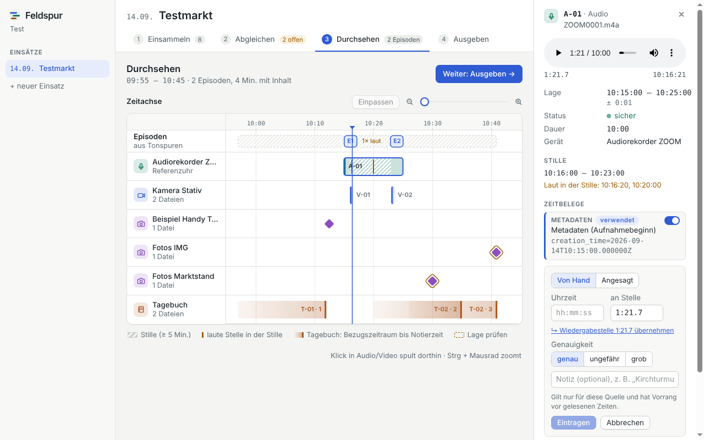

# Durchsehen {#sec-durchsehen}

Im Schritt **Durchsehen** liegt alles auf einer Zeitachse: eine Spur pro Gerät, darin die Quellen an ihrer Uhrzeit.

{#fig-durchsehen}

## Auf der Zeitachse arbeiten

- Ein **Klick** in eine Audio- oder Videospur spult dorthin und spielt ab; die laufenden Aufnahmen erscheinen in der
  Wiedergabe.
- **Strg + Mausrad** zoomt.
- Ein Klick auf eine Quelle öffnet sie in der Detailleiste.

Die Legende unter der Zeitachse erklärt die Zeichen:

- **Stille (ab 5 Min.)** ist schraffiert, **laute Stellen in der Stille** sind als Strich markiert, damit nichts
  Wichtiges im Leerlauf untergeht.
- **Tagebuch**: der Verlauf zeigt den Bezugszeitraum, die Kante die Notierzeit.
- **Lage prüfen** (gestrichelt): Die Lage dieser Quelle ist unsicher.

Quellen, für die Feldspur noch keine Uhrzeit kennt, liegen unten im Bereich **Ohne Uhrzeit**. Wähle sie aus und gib
ihnen eine Zeit (@sec-abgleichen).

{#fig-wiedergabe}

## Episoden

Eine **Episode** ist ein Zeitraum, in dem eine Aufnahme läuft und nicht nur Stille ist. Lücken unter 5 Minuten
werden verbunden. Dazwischen liegen **Zwischenzeiten**, in denen nur Fotos und Tagebucheinträge entstanden sind.
Episoden helfen, lange Feldtage mit vergessenem Diktiergerät kompakt auszugeben (@sec-ausgeben).

Von hier aus geht es weiter zum Abtippen des Tagebuchs (@sec-tagebuch) und zum Mitschreiben (@sec-mitschreiben).
