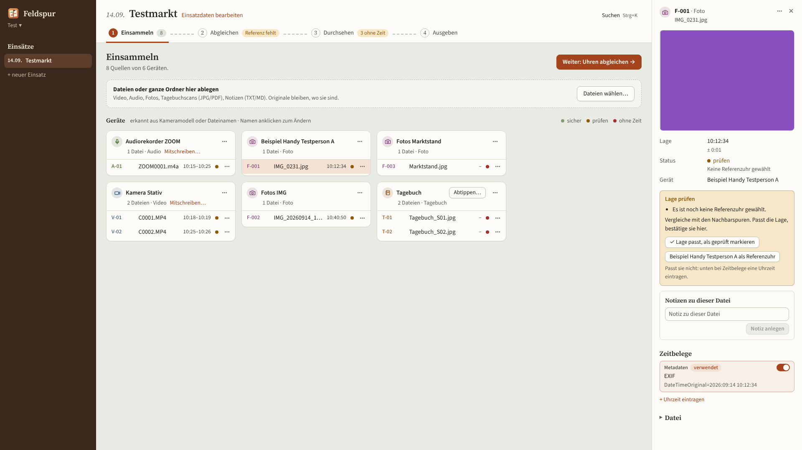

# Einsammeln {#sec-einsammeln}

Zieh alle Aufzeichnungen des Einsatzes in das Fenster: einzelne Dateien oder ganze Ordner. Feldspur liest dabei für
jede Datei

- die **Art** (Video, Audio, Foto, Tagebuchscan als JPG oder PDF, Notiz als TXT oder MD),
- die **Länge** bei Audio und Video,
- eine **Prüfsumme** (SHA-256), mit der sich später belegen lässt, dass das Original unverändert ist,
- alle **Zeitbelege**, die es findet: Aufnahmezeit aus den Metadaten (z. B. EXIF bei Fotos, `creation_time` bei
  Videos, BWF bei Rekorder-WAVs) und Uhrzeiten im Dateinamen.

Begleitdateien, die Kameras neben die Aufnahmen legen, überspringt Feldspur. Dateien, die schon im Einsatz sind,
werden nicht doppelt übernommen.

{#fig-einsammeln}

## Geräte

Feldspur gruppiert die Quellen nach **Geräten**, weil jedes Gerät seine eigene Uhr hat. Es erkennt das Gerät am
Kameramodell in den Metadaten oder an der Art, wie die Dateien benannt sind. Jede Quelle bekommt ein Kurzzeichen wie
im Begleitprotokoll: `V-01` für Video, `A-01` für Audio, `F-001` für Fotos, `T-01` für Tagebuchseiten.

Über das Menü an jeder Quelle kannst du nachhelfen:

- **Umbenennen** eines Geräts, z. B. „Kamera Stativ“ oder „Handy Testperson A“.
- **In anderes Gerät verschieben** oder Geräte **zusammenlegen**, wenn Feldspur zwei Geräte vermutet, wo nur eins war.
- **Setzt Aufnahme fort …**: Viele Geräte teilen lange Aufnahmen in mehrere Dateien. Solche Folgeaufnahmen erkennt
  Feldspur meist selbst (gleiches Gerät, Beginn direkt am Ende der vorigen Datei, oder GoPro-Kapitel). Eine
  Folgeaufnahme ohne eigene Zeit beginnt am Ende der vorigen.
- **Als weiteres Bild zu Seite …**: eine Rückseite oder ein zweiter Scan derselben Tagebuchseite. Das Bild übernimmt
  die Zeit der Seite.
- **Zeitzone der Geräteuhr**, falls ein Gerät auf eine andere Zeitzone gestellt war als der Einsatz.
- **Entfernen** nimmt die Quelle aus dem Projekt; die Originaldatei bleibt, wo sie ist.

Wenn alles eingesammelt ist, geht es mit **Weiter** zum Abgleichen.
