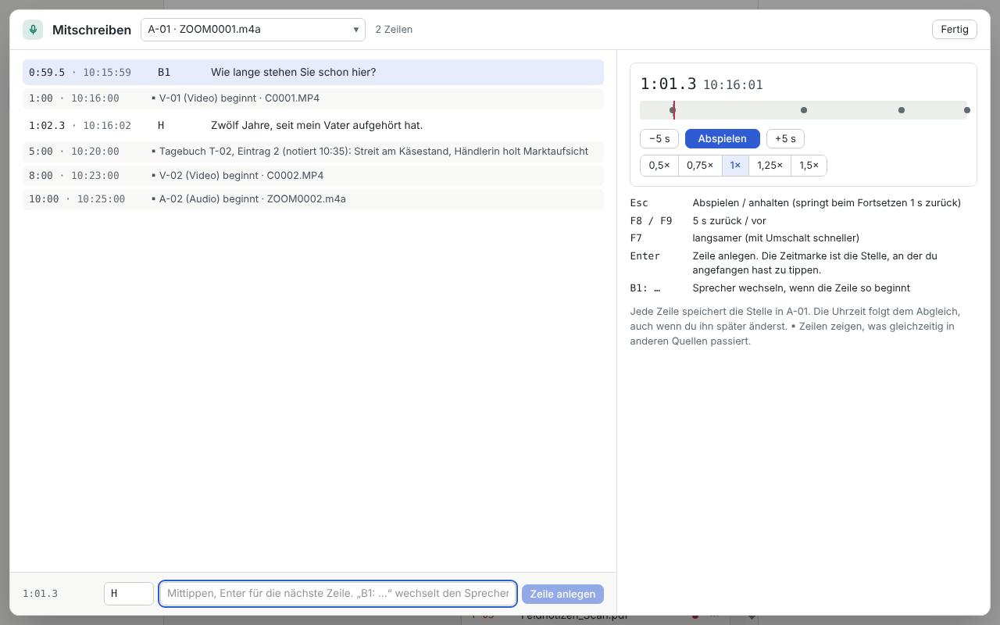

# Mitschreiben {#sec-mitschreiben}

Feldspur transkribiert **nicht automatisch**. Stattdessen tippst du mit, während die Aufnahme läuft, und Feldspur
setzt die Zeitmarken für dich.

{#fig-mitschreiben}

## So geht's

Öffne in der Detailleiste einer Audio- oder Videoquelle das Mitschreiben und wähle die **Tonquelle**. Dann:

- Tippe los. **Enter** legt die Zeile an und beginnt die nächste. Die Zeitmarke ist die Stelle, an der du angefangen
  hast zu tippen.
- Beginnt eine Zeile mit einem Kürzel wie `B1:`, wechselt der **Sprecher**.
- Eine Zeitmarke lässt sich nachträglich auf die aktuelle Stelle setzen; **Hierhin springen** spielt eine Zeile ab.

Tastenkürzel:

| Taste                 | Wirkung                                                   |
| --------------------- | --------------------------------------------------------- |
| Enter                 | Zeile anlegen, nächste beginnen                           |
| Abspielen / anhalten  | beim Fortsetzen springt die Wiedergabe 1 s zurück         |
| F8 / F9               | 5 Sekunden zurück / vor                                   |
| langsamer             | mit Umschalt schneller                                    |

Feldspur speichert zu jeder Zeile die Stelle in der Aufnahme. Die Uhrzeit folgt aus dem Abgleich; wenn du später eine
Uhr korrigierst, wandert die Mitschrift mit.

## Transkript importieren

Hast du eine Aufnahme schon anderswo transkribiert, etwa mit Whisper oder in MAXQDA, kannst du das Transkript über
**Transkript importieren…** in der Detailleiste einlesen. Feldspur versteht SRT, WebVTT, JSON (Whisper) und TSV.
Wähle, ob es **zur Mitschrift hinzugefügt** wird oder sie **ersetzt**.
