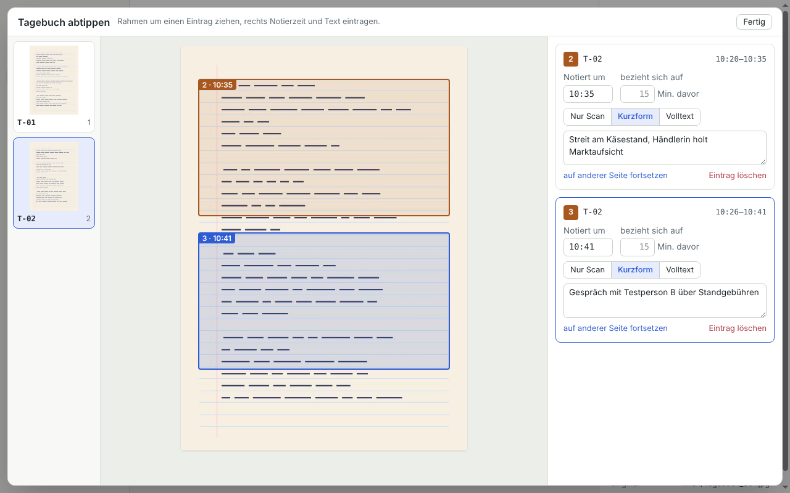

# Tagebuch abtippen {#sec-tagebuch}

Feldnotizen entstehen selten genau dann, wenn etwas passiert. Ein Eintrag, der um 14:23 notiert wurde, betrifft oft
schon, was um 14:16 geschah. Feldspur trennt deshalb die **Seite** (der Scan) vom **Eintrag** (ein Rahmen auf der
Seite mit eigener Zeit).

{#fig-tagebuch}

## Randnotiz der Seite

Steht am Rand einer Seite eine Uhrzeit, trägst du sie in der Detailleiste als **Randnotiz** ein. Daraus ergibt sich,
auf welchen Zeitraum sich die Seite bezieht, auch ohne einzelne Einträge.

## Einträge

Öffne die Seite mit **Tagebuch abtippen** und zieh einen Rahmen um einen Eintrag. Dann trägst du ein:

- **Notiert um**: die Uhrzeit, zu der du den Eintrag geschrieben hast.
- **bezieht sich auf … Min. davor**: wie weit der Eintrag zurückreicht. Der Standard steht in den Einsatzdaten.
- wie du ihn erfasst:
  - **Volltext**: wortgetreu abgetippt,
  - **Kurzform**: Stichworte, worum es geht,
  - **Nur Scan**: nicht abtippen, der Scan steht für sich.

Ein Eintrag kann auf einer anderen Seite weitergehen; dann ziehst du dort einen weiteren Rahmen für denselben Eintrag.
Eine Seite kann umgekehrt mehrere Einträge mit verschiedenen Zeiten enthalten.

Zeitgerüst, Montagevideo, Mitschrift und Suche führen jeden Eintrag an seiner **Notierzeit**. Der Bezugszeitraum steht
als Hinweis dabei.
